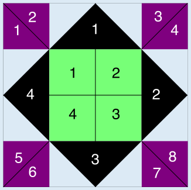

**Antwort A** ist richtig.

Zunächst muss man herausfinden, ob die Fliesen der drei Sorten so gelegt werden können, dass sie das jeweilige Rangoli ergeben. Anschließend ist zu prüfen, dass für jede Sorte die Anzahl der genutzten Fliesen nicht größer ist als die Zahl der verfügbaren Fliesen. Das Bild zeigt eine Möglichkeit, wie Rangoli A gelegt werden kann.

Die folgende Tabelle gibt an, wie viele Fliesen von jeder Sorte für die verschiedenen Rangoli benötigt werden und ob Indu genug Fliesen hat, um das Muster zu legen.

| Rangoli | Benötigte Fliesen | Kann Indu das Rangoli legen? |
|---|---|---|
| A | 8 lila Dreiecke, 4 grüne Quadrate, 4 schwarze Dreiecke | Ja, sie hat genug Fliesen von jeder Sorte. |
| B | 12 lila Dreiecke, 4 grüne Quadrate, 6 schwarze Dreiecke | Nein, sie hat nur 8 lila Dreiecke. |
| C | 4 lila Dreiecke, 8 grüne Quadrate, 4 schwarze Dreiecke | Nein, sie hat nur 4 grüne Quadrate. |
| D | 12 lila Dreiecke, 2 grüne Quadrate, 4 schwarze Dreiecke | Nein, sie hat nur 8 lila Dreiecke. |

Indu kann also nur Rangoli A mit ihren Fliesen legen.

## Das ist Informatik!

Rangoli ist eine Kunstform, die in Indien traditionell aus gefärbtem Reis und Mehl, aber auch aus farbigem Sand oder Blüten erstellt wird. Rangoli haben vor allem dekorative Zwecke, sind aber auch mit regionalen, familiären oder auch religiösen Traditionen verbunden.

In dieser Biberaufgabe muss man komplexe Formen in kleinere Formen zerlegen, die man dann mit den vorhandenen Grundformen abgleichen kann. So kann man erkennen, wie viele von den Grundformen jeweils benötigt werden. Die Zerlegung von Strukturen in Unterstrukturen heißt auch Dekomposition – und wird in der Informatik zum Beispiel angewandt, wenn die gewünschte Funktionsweise eines Programms in Teilfunktionen zerlegt wird, die man als überschaubare und leicht zu testende Unterprogramme implementieren kann.

Dekomposition wird als ein wichtiger Bestandteil des „digitalen Denkens“ (engl.: computational thinking) angesehen, das nicht nur für Informatikerinnen und Informatiker wichtig ist, sondern allgemein beim Lösen von Problemen hilfreich sein kann.
