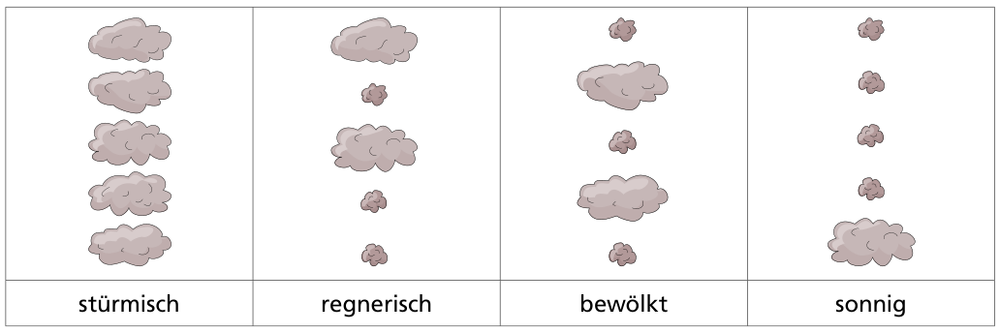
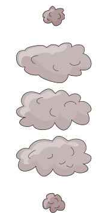

Der Wetter-Biber ist oben auf dem Berg und sendet Rauchzeichen zu den Bibern im Tal. Die Rauchzeichen bestehen aus fünf großen oder kleinen Rauchwolken. Damit sendet der Wetter-Biber vier verschiedene Nachrichten:

Eines Tages sehen die Biber im Tal dieses Rauchzeichen:

Das ging schief. Der Wetter-Biber auf dem Berg hat einen Fehler gemacht. Eine der fünf Rauchwolken hat die falsche Größe.

**Welche Nachricht wollte der Wetter-Biber senden?**
