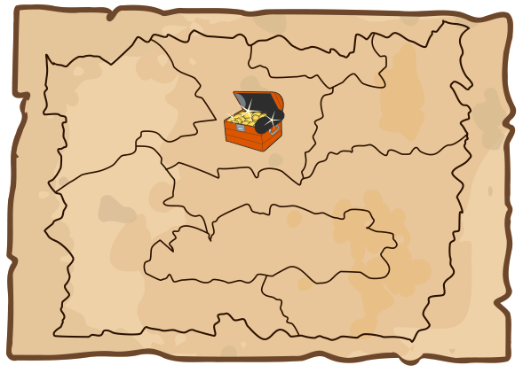

Die Landkarte zeigt das Reich des Biberkönigs mit seinen sieben Provinzen. In einer Provinz hat der König seinen Schatz versteckt.

Der König will die Lage des Schatzes geheim halten. Deshalb hat er eine besondere Schatzkarte gezeichnet. Für jede Provinz ist darin ein Kreis eingezeichnet. Eine Linie zwischen zwei Provinz-Kreisen zeigt, dass die beiden Provinzen aneinander angrenzen. Der Kreis für die Provinz mit dem Schatz ist markiert. Um mögliche Räuber zu verwirren, hat der König zusätzlich vier falsche Schatzkarten gezeichnet.

**Welches ist die richtige Schatzkarte?**
