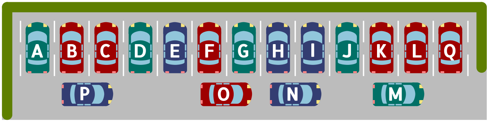

Auf dem „Schiebeparkplatz“ in Tübingen darf man Wagen auch quer vor den normalen Plätzen abstellen. Ein quer stehender Wagen, der einen anderen Wagen blockiert, wird vorsichtig vorwärts oder rückwärts verschoben. Dann kann der blockierte Wagen ausfahren.

Das Bild zeigt ein Beispiel: Wagen A wird nicht blockiert und kann ausfahren. Wagen L wird blockiert. Wenn Wagen M verschoben wird, kann Wagen L ausfahren. Im Beispiel wird ein Wagen zweifach blockiert: Zwei andere Wagen müssen verschoben werden, damit er ausfahren kann.

**Welcher Wagen wird zweifach blockiert?** Klicke ihn an.
