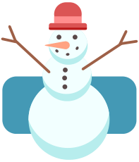

Die Schneemänner bekommen Hüte. Sie stellen sich in vier Reihen an. Jede Reihe sucht sich den passenden Hutstapel aus. Dann nimmt der erste Schneemann (links) den obersten Hut vom Stapel, der zweite den nächsten Hut – und so weiter. Am Ende hat jeder den passenden Hut: Der kleinste Schneemann hat den kleinsten Hut, der zweitkleinste Schneemann den zweitkleinsten Hut – und so weiter.

**Verbinde jede Schneemann-Reihe mit dem passenden Hutstapel.**
