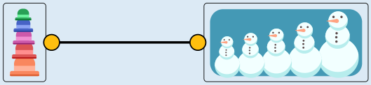
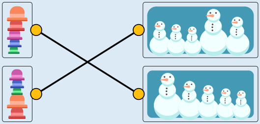

Der oberste Hutstapel passt zur obersten Schneemannreihe. In der Reihe stehen die Schneemänner nach Größe geordnet, der kleinste zuerst. Auf dem Stapel liegen die Hüte nach Größe geordnet, der kleinste zuoberst.

Der zweite Hutstapel passt zur dritten Schneemannreihe. In der Reihe stehen die Schneemänner nach Größe geordnet, der größte zuerst. Auf dem Stapel liegen die Hüte nach Größe geordnet, der größte zuoberst. Der dritte Hutstapel passt zur zweiten Schneemannreihe.

Um das zu erkennen, ordnen wir Schneemännern und Hüten Nummern zu, der Größe nach: Der größte Schneemann bzw. der größte Hut bekommt die Nummer 5, der zweitgrößte Schneemann bzw. Hut bekommt Nummer 4, und so weiter.

Die Schneemänner in der zweiten Reihe haben dann von vorne die Nummern 3-2-1-5-4. Die Hüte auf dem dritten Stapel haben von oben die Nummern 3-2-1-5-4 – das passt. Die Schneemänner in der vierten Reihe haben von vorne die Nummern 4-3-5-1-2. Dazu passt der vierte Hutstapel: Darin haben die Hüte von oben auch die Nummern 4-3-5-1-2.

## Das ist Informatik!

Kenner früherer Biberaufgaben vermuten vielleicht, was jetzt kommt. Allzu offensichtlich sind die Bezüge zu den Datenstrukturen Stapel und Reihe bzw. Schlange bei Hüten und Schneemännern. Doch die Erklärung der Lösung legt ein anderes, viel grundsätzlicheres Informatikthema nahe: die Abstraktion – die bei der Aufgabe „Schatzkarte“ schon kurz angesprochen wurde. Um bei den etwas komplizierteren Fällen erläutern zu können, welcher Hutstapel zu welcher Schneemann-Reihe passt, haben wir aufgehört, über Hüte und Schneemänner zu reden. Stattdessen haben wir Nummern verwendet, welche die Größe von sowohl Hüten als auch Schneemännern beschreiben. So konnten die Abfolgen der Größen jeweils aufgelistet und die Größen-Listen miteinander verglichen werden. Alle anderen Eigenschaften von Hüten (wie Farben oder Form) und Schneemännern (etwa die Anzahl der Knöpfe auf der mittleren Kugel) können in dieser Biberaufgabe ignoriert werden.

Die Darstellung von Hutstapeln und Schneemannreihen als Größenlisten ist eine Abstraktion oder Reduktion auf die für das gegebene Problem relevanten Informationen. Aber sollen Hüte und Schneemänner immer nur bezüglich ihrer Größe betrachtet werden? Vielleicht erfordert das nächste Hut-Schneemann-Problem ganz andere Informationen? Informatiksysteme arbeiten immer mit Abstraktion: mit einer Abbildung der Realität auf die Möglichkeiten binärer Repräsentation und algorithmischer Prozesse. Bei Abstraktion geht Information verloren. Das ist nicht grundsätzlich schlecht, aber jede Informatikerin und jeder Informatiker sollte sich dessen bewusst sein.
