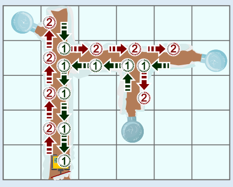
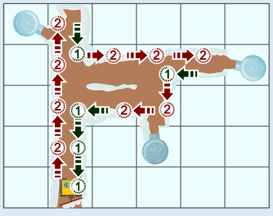

**23** ist die richtige Antwort.

Da es weniger Zeit benötigt, ein Quadrat erneut zu befahren, welches bereits geräumt wurde, ist es sinnvoll, bereits geräumte Wege so häufig wie möglich wiederzuverwenden. Nach diesem Grundsatz können zwei Routen berechnet werden, eine davon ist unten zu sehen. Das Bild zeigt, wie viele Minuten der Roboter für die Fahrten zu den nächsten Quadraten jeweils benötigt. Die Summe der Zahlen ist 24, der Roboter benötigt also 24 Minuten auf diesem Weg. Aber ist das schon der schnellste Weg?

Bislang haben wir alle geräumten Quadrate wiederverwendet, um Zeit zu sparen. Nun können wir noch nach Abkürzungen suchen, mit denen wir noch mehr Zeit sparen können. Und wirklich: Auf dem Weg vom letzten Iglu zur Startposition fährt der Roboter einen Umweg über bereits geräumte Quadrate. Wenn er den abkürzt, muss er zwar ein weiteres Quadrat räumen, benötigt dafür aber nur 2 Minuten statt 3 Minuten für den Umweg (unteres Bild). Auf diesem Weg dauert die Fahrt des Roboters also insgesamt nur 23 Minuten. Schneller geht es nicht, denn es gibt keine weitere Abkürzung.

## Das ist Informatik!

In dieser Biberaufgabe wird nach einem Wegenetz gesucht, das alle Orte (die Iglus und die Startposition des Roboters) mit minimalen Kosten (die Zeit, die die Fahrt des Roboters dauert) verbindet. Solch ein Wegenetz enthält nicht unbedingt die kürzesten Wege zwischen allen Orten, aber die Kosten, um es zu erstellen, sind so klein wie möglich. Solche Wegenetze nennt man „Steinerbäume“. Sie werden zum Beispiel bei der Konstruktion von Computerplatinen oder beim Bau von wenig genutzten Eisenbahnnetzen für Güter erstellt.

Für eine Menge von Orten und ein Kostenmaß (häufig die geometrische Entfernung) einen Steinerbaum zu finden ist eines der schweren, zur Klasse der „NP-vollständigen Probleme“ gehörenden Optimierungsprobleme – so wie „Set Cover“ aus der Aufgabe „Leckeres Holz“ weiter vorne in diesem Biberheft. Dass hier die Kosten für einen Weg noch abhängig von der Wahl anderer Wege sein können, macht das Problem sogar noch schwerer.

https://de.wikipedia.org/wiki/Steinerbaumproblem
