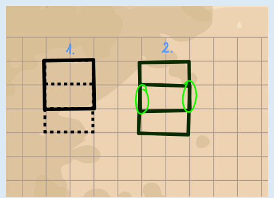

Mia benutzt **Stempel A**.

Das ist der Stempel mit dem großen Quadrat. Im ersten Schritt stempelt sie den oberen Teil. Danach stempelt sie den unteren Teil. Hier überlappt sich die Farbe an zwei Stellen. Die grünen Markierungen zeigen diese Stellen.

Mia könnte Figur 3 auch mit den Stempeln C und D stempeln. Doch Stempel C müsste sie achtmal und Stempel D sogar vierzehnmal benutzen. Mit Stempel B kann Figur 3 nicht gestempelt werden.

## Das ist Informatik!

Ein wunderschönes Bild, doch wie hat der Maler es nur geschafft, dass die Farben so glänzen? Eine alte Geige, aber warum klingt sie so besonders? Die meisten Menschen möchten gerne verstehen, wie Dinge funktionieren. Das wird schwierig, wenn es niemanden (mehr) gibt, der das erklären kann oder will. In der Informatik stellen sich ähnliche Fragen: Ein schönes altes Computerspiel, aber der Programmcode ist nicht mehr aufzutreiben: Wie kann das Spiel auf moderne Computer übertragen werden? Eine Schadsoftware ist aufgetaucht, deren Entwickler unbekannt sind: Wie kann man Computer dagegen schützen? Da muss man sich selber helfen und auf geschickte Weise versuchen, aus dem Maschinencode von Spiel oder Schadsoftware auf deren Programmcode zu schließen. Wenn man Methoden anwendet, um die Funktionsweise eines (technischen) Konstruktes zu verstehen, wird von „Reverse Engineering“ gesprochen. So einfach wie beim Stempelbild in dieser Biberaufgabe geht Reverse Engineering aber in den allermeisten Fällen nicht. Deshalb sind erfahrene Informatikerinnen und Informatiker gefragt, die auf verschiedene in der Informatik entwickelte Werkzeuge zurückgreifen.
