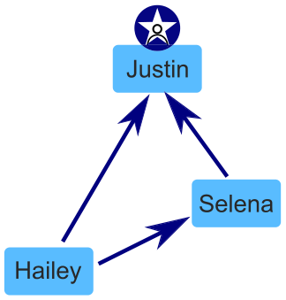

Im sozialen Netzwerk „TeeniGram“ können Mitglieder anderen Mitgliedern „folgen“. In TeeniGram gibt es außerdem Mitglieder-Gruppen. In einer Gruppe nennt man ein Mitglied „Superstar“, wenn

- jedes andere Mitglied der Gruppe ihm folgt und
- es selbst keinem anderen Mitglied der Gruppe folgt.

*Ein Beispiel:* Eine TeeniGram-Gruppe hat drei Mitglieder, nämlich Hailey, Selena und Justin.

- Hailey folgt Justin und Selena.
- Selena folgt Justin.
- Justin folgt keinem Mitglied der Gruppe.

Justin ist ein Superstar in dieser Gruppe.

Eine andere TeeniGram-Gruppe hat diese Mitglieder: Alan, Don, Frances, Grace und Robin.

- Alan folgt Don und Grace.
- Don folgt Grace und Robin.
- Frances folgt Alan, Grace und Robin.
- Robin folgt Alan und Grace.

**Gibt es einen Superstar in dieser Gruppe?**
