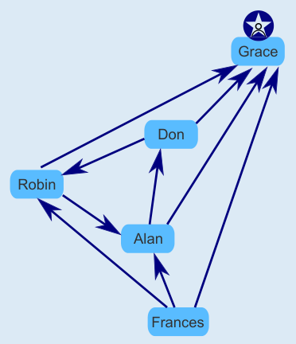

**Antwort C** ist richtig.

Grace ist ein Superstar in dieser Gruppe. Sie erfüllt beide Bedingungen: Jedes andere Mitglied der Gruppe (also Alan, Don, Frances und Robin) folgt ihr, und sie selbst folgt keinem Mitglied der Gruppe.

- A ist falsch, weil Alan zwei anderen Mitgliedern folgt (Don und Grace).
- B ist falsch, weil sowohl Frances als auch Robin anderen Mitgliedern folgen. Außerdem ergibt sich aus den Superstar-Bedingungen, dass es höchstens einen Superstar in einer Gruppe geben kann.
- D ist falsch, weil C richtig ist und Grace ein Superstar in dieser Gruppe ist.

## Das ist Informatik!

Ein soziales Netzwerk wie TeeniGram entsteht durch die Beziehungen zwischen seinen Mitgliedern. Es gibt unterschiedliche Arten solcher Beziehungen: Wenn Mitglied A einem anderen Mitglied B „folgt“, muss B nicht auch A folgen; eine solche Beziehung nennt man auch gerichtet. Wenn die beiden Mitglieder A und B aber „Freunde“ sind, ist das gegenseitig oder ungerichtet. Beide Arten von Beziehungen können mit Hilfe von Graphen modelliert werden. Für die Auswertung und Untersuchung solcher Beziehungsmodelle kennt die Informatik viele gute Algorithmen.

Echte soziale Netzwerke bilden sehr große Graphen. Die Unternehmen, die diese Netzwerke realisieren, sind sehr daran interessiert, Strukturen in ihren Beziehungs-Graphen zu erkennen oder zu entdecken – wie etwa den Superstar in einer (möglicherweise sehr großen) Gruppe zu bestimmen. Auch wenn es in einem sozialen Netzwerk keine Gruppen gibt, kann es sich lohnen, Mitglieder zu finden, denen viele andere Mitglieder folgen, die aber selbst nur wenigen Mitgliedern folgen. Solche Mitglieder können als Meinungsführer oder „Influencer“ wirken.

https://en.wikipedia.org/wiki/Social_network_analysis
