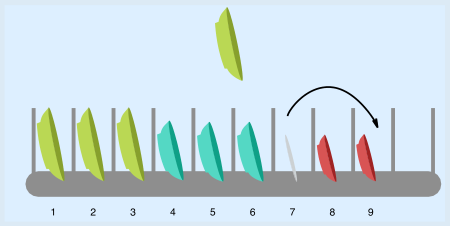
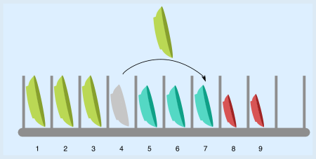
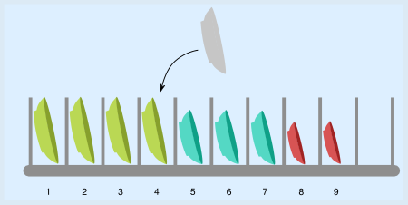

Man kann den Teller einsortieren, indem man zwei Teller umstellt.

Zuerst stellt man den Teller von Position 7 auf Position 9.

Dann stellt man den Teller von Position 4 auf Position 7.

Dann kann man den neuen Teller an Position 4 einsortieren.

Geht es vielleicht mit noch weniger Umstellungen? Es gibt keine Lücke bei den großen Tellern, in die man den neuen großen Teller stellen könnte. Man muss also einen großen Teller oder den mittleren Teller auf Position 4 umstellen, um die Lücke zu schaffen. Wenn man diesen Teller auf eine freie Position stellen würde, wären die Teller in der Spülmaschine nicht mehr sortiert. Man muss also mindestens noch einen weiteren Teller umstellen, um für diesen Teller eine Lücke zu schaffen oder die Sortierung wieder herzustellen. Folglich muss man mindestens zwei Teller umstellen; besser geht es nicht.

## Das ist Informatik!

Die Ordnung in der Spülmaschine soll, wie man hört, in vielen Haushalten ein beliebtes Thema sein. Darüber, wie wichtig diese Ordnung ist, kann man unterschiedlicher Meinung sein. Dass Ordnung im Computer aber sehr wichtig ist, darüber wurde bei der Biberaufgabe „Kanalsystem“ weiter vorne in diesem Biberheft bereits gesprochen. Und bei der Aufgabe „Anproben“ wird erklärt, wie Computerprogramme in sortierten Daten sehr schnell suchen können. Da Computer ständig in Daten suchen müssen, lohnt es sich, Daten zu sortieren und ihre Sortierung beim Einfügen neuer Daten zu erhalten.

Ein allgemeines Verfahren (also ein Algorithmus), der die Sortierung in der Spülmaschine erhalten kann, lautet so:

- Bewege alle Teller, die kleiner sind als der neue Teller, um eine Position nach rechts.
- Stelle den neuen Teller in die so entstandene Lücke.

Dieses Verfahren würde im Fall dieser Biberaufgabe fünf Teller umstellen, während die vorgestellte Lösung mit zwei Umstellungen auskommt.

Dieser Einfüge-Algorithmus kann analog auch von Computerprogrammen zum Einfügen von Daten in eine Folge sortierter Daten verwendet werden. Aber er ist, wie sein Einsatz bei der Teller-Ordnung andeutet, nicht besonders schnell. Im schlechtesten Fall wird der Algorithmus alle bereits vorhandenen Teller bzw. Daten bewegen müssen. Bei großen Datenmengen bedeutet das viel Arbeit für den Computer. Informatikerinnen und Informatiker entwickeln deshalb clevere Algorithmen, mit denen es schneller geht. Zum Beispiel kann ausgenutzt werden, wenn es viele gleiche Daten in der sortierten Folge gibt – wie bei den Tellern in dieser Biberaufgabe.
