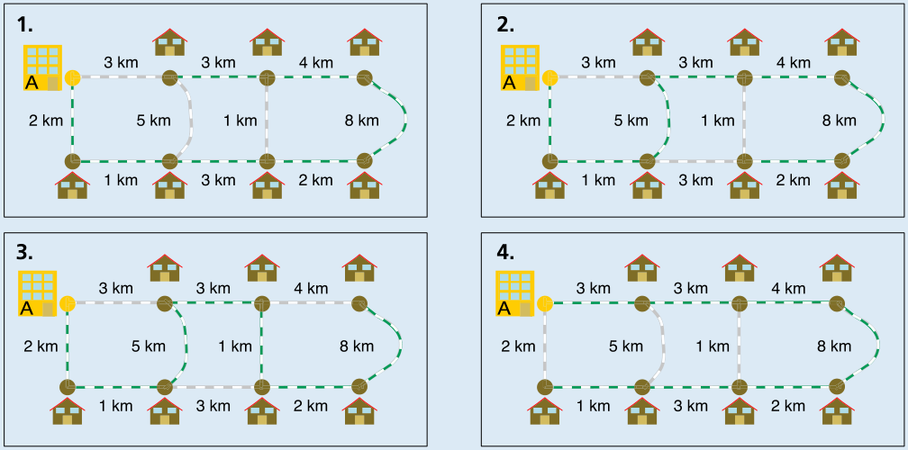

**D (25 km)** ist die richtige Antwort.

Im Heft steht bei der Lösung irrtümlich „B ist die richtige Antwort“; die Rechnung dort ergibt aber 25 km, und das ist Antwort D.

Es gibt nur vier Möglichkeiten, beim Lager zu starten und alle Orte genau einmal anzufahren:

Die Längen dieser vier Touren sind:

- Tour 1: 2 + 1 + 3 + 2 + 8 + 4 + 3 = 23
- Tour 2: 2 + 1 + 5 + 3 + 4 + 8 + 2 = 25
- Tour 3: 2 + 1 + 5 + 3 + 1 + 2 + 8 = 22
- Tour 4: 3 + 3 + 4 + 8 + 2 + 3 + 1 = 24

Tour 2 ist mit 25 km die längste. Sie ist Bens Trainingstour.

## Das ist Informatik!

Auf seiner Trainingstour möchte Ben alle Zielorte genau einmal anfahren. Für die Karte mit Zielorten und Strecken löst er damit das Hamiltonpfad-Problem. Die Karte ist nämlich wie ein Graph, eine mathematische Struktur aus Knoten und Kanten: Die Zielorte entsprechen den Knoten, und die Strecken den Kanten. Ein Hamiltonpfad ist ein Weg über Kanten des Graphen, bei dem alle Knoten genau einmal besucht werden. Da Ben außerdem die Längen der Strecken kennt und nicht nur irgendeine Tour fahren will, sondern eine Trainingstour, sucht er den längsten Hamiltonpfad im Karten-Graph.

Zu den wichtigsten Aufgaben der Informatik gehört es, die Schwierigkeit von Problemen einzuschätzen. Das Hamiltonpfad-Problem, also genau genommen die Entscheidung darüber, ob es in einem Graph einen Hamiltonpfad gibt, ist eines der berühmten NP-vollständigen Probleme und damit eines der schwierigsten Probleme, die die Informatik kennt. Den längsten Hamilton-Pfad zu bestimmen ist mindestens genau so schwierig. Das gilt allerdings nur bei allgemeiner Betrachtung. Wenn der Graph so übersichtlich ist wie die Streckenkarte in dieser Biberaufgabe, lässt sich der längste Hamiltonpfad gut bestimmen. Generell lässt sich die Informatik von einem schwierigen Problem nicht beeindrucken. Sie sucht dann unter anderem nach Spezialfällen, für die man das Problem doch gut lösen kann. Für das Hamiltonpfad-Problem sind einige bekannt.

https://de.m.wikipedia.org/wiki/Hamiltonkreisproblem
