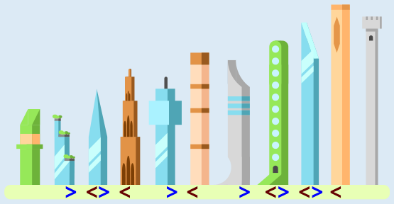

Drei Türme stehen richtig: die hellblaue Spitze (der dritte Turm), der grüne Turm mit Punkten (der achte) und die blaue Kristallspitze (der neunte). Bei ihnen sind jeweils alle Türme links von ihnen kleiner und alle Türme rechts von ihnen größer. Das kann man an gestrichelten waagerechten Linien erkennen, die genau auf der Höhe der Türme verlaufen.

Ein Verfahren, mit dem man die „richtigen“ Türme bestimmen kann, geht so: Zuerst geht man die Türme der Reihe nach durch und markiert einen Turm mit <, wenn alle Türme links von ihm kleiner sind. Dann geht man die Türme noch einmal durch und markiert einen Turm mit >, wenn alle Türme rechts von ihm größer sind. Alle Türme, die danach mit < > markiert sind, erfüllen beide Bedingungen und stehen richtig.

## Das ist Informatik!

In dieser Biberaufgabe werden die Türme nach und nach anhand ihrer Höhe verglichen, um festzustellen, ob sie „richtig“ stehen. Ganz ähnlich kann man vorgehen, wenn man dafür sorgen will, dass alle Türme richtig stehen. Dazu geht man ebenfalls die Türme durch und vergleicht die Höhen benachbarter Türme miteinander. Findet man dabei einen Turm, der nicht richtig steht, weil der Turm direkt links von ihm größer ist, vertauscht man die beiden Türme. Das wiederholt man so lange, bis alle Türme richtig stehen. Dann ist die Turmreihe der Höhe nach sortiert.

Dieses Sortierverfahren kennt die Informatik unter dem Namen „Bubble-Sort“. Es funktioniert zuverlässig, aber nicht besonders schnell. Das macht sich besonders dann bemerkbar, wenn es um das Sortieren großer Datenmengen geht. Weil das Sortieren eine der wichtigsten Beschäftigungen von Computern ist, haben sich Informatikerinnen und Informatiker viele verschiedene und insbesondere schnelle Sortierverfahren überlegt. Sie werden unter anderem dadurch charakterisiert, wie viele Vergleiche beim Sortieren benötigt werden. Während Bubble Sort für 1.000 zu sortierende Elemente 1.000.000 Vergleiche benötigen kann, kommen schnellere Verfahren mit 10.000 Vergleichen aus. Bei 1.000.000 Elementen sind es schon 1.000.000.000.000 zu 20.000.000 Vergleichen. Auch wenn diese Zahlen nur grobe Annäherungen sind, ist der Unterschied jedenfalls groß.
