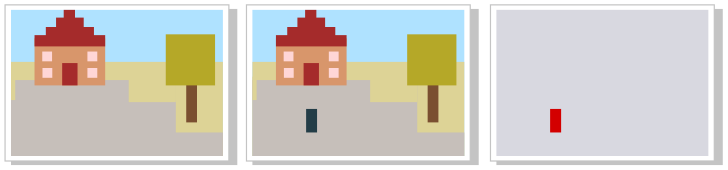
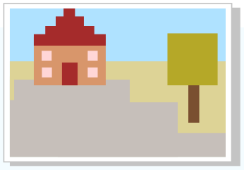

Am Marktplatz ist eine Überwachungskamera installiert. Sie macht alle 10 Sekunden ein Foto. Eine Software vergleicht jedes neue Foto mit dem vorherigen und erzeugt ein „Unterschiedsbild“. Dieses Bild enthält rote Pixelquadrate genau dort, wo sich die beiden verglichenen Fotos unterscheiden.

Ein Beispiel: Links sind zwei Fotos vom Marktplatz, rechts ist das Unterschiedsbild des zweiten zum ersten Foto.

Nun sollst du über sechs hintereinander aufgenommene Fotos nachdenken. Unten siehst du das erste Foto, aber für die folgenden fünf Fotos jeweils nur das Unterschiedsbild zum vorherigen Foto. Zwischen den Fotos wurde immer ein neues Ereignis beobachtet, und zwar jeweils eines aus dieser Liste:

| | |
|---|---|
| A | Tom trifft Tina. |
| B | Jemand öffnet die Rathaustür. |
| C | Tom und Tina gehen Arm in Arm. |
| D | Wind kommt auf. |
| E | Jemand schließt die Rathaustür. |

**Wann wurde welches Ereignis beobachtet?** Ordne jedem Unterschiedsbild das Ereignis zu.
