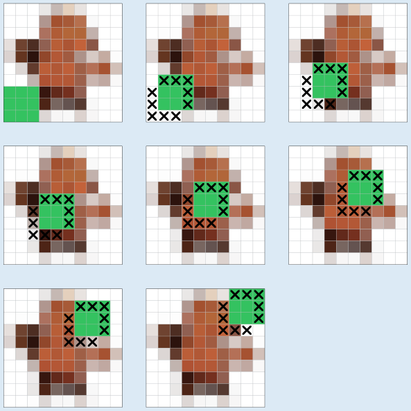

**D (170)** ist die richtige Antwort.

So sieht es aus, wenn man in den Einzelbildern des Videos die geänderten Bildpunkte markiert:

Jedes Einzelbild besteht aus 10 × 10 = 100 Bildpunkten. Für das erste Einzelbild müssen also 100 Bildpunkte gespeichert werden. Für jedes weitere Einzelbild müssen die geänderten Bildpunkte gespeichert werden. Das sind die fünf Bildpunkte unten links vom Quadrat, die durch die Bildpunkte des Hintergrunds ersetzt werden, sowie die fünf Bildpunkte oben rechts im Quadrat, die den bisherigen Hintergrund überdecken. Pro Einzelbild werden also 10 Bildpunkte geändert und müssen gespeichert werden. Das Quadrat braucht nach dem ersten Einzelbild 7 weitere Einzelbilder, um sich von unten links nach oben rechts zu bewegen. Für diese weiteren Einzelbilder müssen also 10 × 7 = 70 Bildpunkte gespeichert werden. Für das gesamte Video müssen 170 Bildpunkte gespeichert werden.

## Das ist Informatik!

Computer – und damit auch Smartphones – ohne Videos? In diesem Biberjahr 2019 ist das nicht vorstellbar. Videoplattformen im Internet oder das Streaming von Filmen und Serien gehören zum Alltag zumindest jüngerer Menschen. Dabei ist das nicht selbstverständlich. Die Aufgabe deutet schon an, dass bei Videos große Datenmengen zusammenkommen. In der Realität sind die Videos nicht so klein wie in dieser Biberaufgabe. Ein Video im HD-Format hat 1920 × 1080 und damit über 2 Millionen Bildpunkte, und zwar für jedes Einzelbild. Bei den lange Zeit üblichen 3 Byte pro Bildpunkt ist ein Einzelbild also gut 6 Millionen Byte groß. Wenn man von den bei Kinofilmen gebräuchlichen 24 Einzelbildern pro Sekunde ausgeht, kommt ein 30-minütiges Video (zum Beispiel eine Serienfolge) auf 24 × 60 × 30 = 43.200 Einzelbilder und damit auf einen Speicherbedarf von grob 260 Gigabyte – und das wäre auch die Datenmenge, die beim Streaming über die Internetverbindung zu laden wäre. Das wäre selbst bei heutigen Festplatten und Downloadraten sehr viel.

In der Informatik wird deshalb schon lange daran gearbeitet, Videodaten möglichst gut zu komprimieren, um deren Speicherbedarf zu verringern. „Möglichst gut“ bedeutet dabei natürlich auch, Verluste bei der Bildqualität nur soweit hinzunehmen, wie das menschliche Auge sie nicht wahrnimmt. Ein wichtiger Bestandteil jeder guten Videokompression ist die Differenzkodierung, bei der nur die Unterschiede zu vorherigen Einzelbildern oder Bildpunkten gespeichert werden – wie in dieser Biberaufgabe.

https://de.wikipedia.org/wiki/Videokompression
