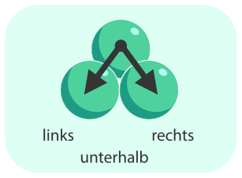
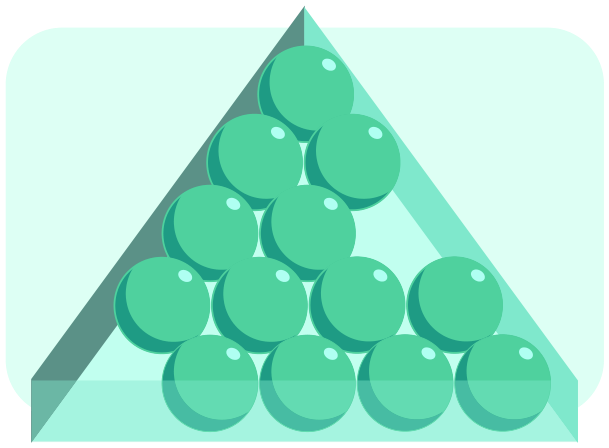

13 Kugeln liegen in einem dreieckigen Kasten (siehe unten). Wenn wir den Kasten an der Spitze anheben und nach vorne kippen, drohen einige Kugeln nach unten zu rollen. Diese Kugeln nennen wir wackelig.

Eine Kugel ist wackelig, wenn (mindestens) eine der beiden folgenden Bedingungen erfüllt ist:

- Es gibt eine Lücke links oder rechts unterhalb der Kugel.
- Es gibt zumindest eine wackelige Kugel links oder rechts unterhalb der Kugel.

**Welche Kugeln sind NICHT wackelig?** Klicke sie an.
