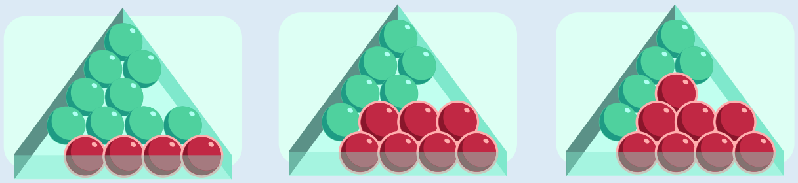

Man kann die wackeligen Kugeln auf folgende Weise bestimmen:

1. Beginne mit der untersten Reihe in dem dreieckigen Kasten und markiere alle Kugeln in dieser Reihe.
2. Mache mit der nächsthöheren Reihe weiter.
3. Markiere alle Kugeln, die auf zwei markierten Kugeln liegen.
4. Wiederhole die Schritte 2 und 3, bis du alle Reihen bearbeitet hast.
5. Alle Kugeln, die jetzt markiert sind, sind nicht wackelig.

Die Bilder illustrieren dieses Verfahren. Ab der vierten Reihe werden keine Kugeln mehr markiert.

Nicht wackelig sind also insgesamt acht Kugeln: die vier der untersten Reihe, drei der zweiten Reihe und eine der dritten Reihe.

## Das ist Informatik!

In dieser Biberaufgabe heißt eine Kugel wackelig, wenn sie eine von zwei Bedingungen erfüllt. Wenn man die zweite Bedingung prüfen will, muss man feststellen, ob die darunter liegenden Kugeln wackelig sind. Dazu muss man eventuell wiederum feststellen, ob die darunter liegenden Kugeln wackelig sind. Das hört sich so an, als ob es endlos weitergehen würde. Tut es aber nicht. Denn der Rückgriff auf das Wackeligsein anderer Kugeln hat eine Richtung: unten. Deshalb ist klar, dass in der unteren Reihe alle Kugeln nicht wackelig sind – es gibt weder Lücken noch Kugeln darunter.

Die Beschreibung bzw. Definition der Wackeligkeit einer Kugel in dieser Biberaufgabe verwendet Rekursion – so wie bei den „Stern-Mobiles“ weiter vorne im Heft: Zur Definition einer Eigenschaft (oder eines Begriffs) wird sie selbst verwendet. Damit das funktioniert und nicht endlos wird, muss eine rekursive Definition einen Basisfall enthalten, den man ohne Rückgriff auf die definierte Eigenschaft entscheiden kann. Für die wackeligen Kugeln ist der Basisfall die Lage in der untersten Reihe.

Die Informatik kennt viele rekursiv beschriebene Strukturen. Deshalb ist es naheliegend, die Abläufe zur Verarbeitung dieser Strukturen auch rekursiv zu programmieren. Das ist in allen verbreiteten Programmiersprachen möglich. Damit die rekursiven Programme nicht endlos laufen, müssen die Programmiererinnen aber unbedingt auf eines achten: den Basisfall!
