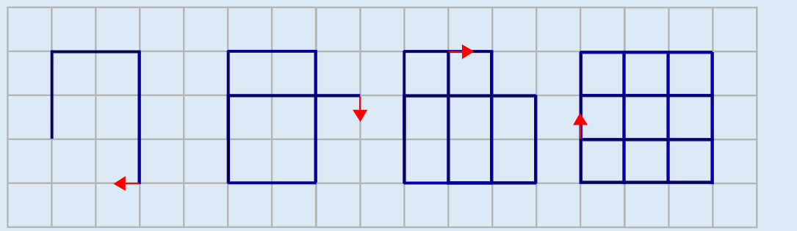

**Antwort B** ist richtig.

Die Zahlen 2, 2, 3 bedeuten, dass der Roboter zunächst 2 Felder vorgeht und sich nach rechts dreht, wieder 2 Felder vorgeht und sich nach rechts dreht und dann 3 Felder vorgeht und sich nach rechts dreht. Danach hat er die Linien im Bild links gezeichnet. Die nächsten Bilder zeigen, welche Linien der Roboter nach weiteren Wiederholungen der drei Schritte gezeichnet hat. Das Bild aus Antwort B entsteht also aus den Zahlen 2, 2, 3, indem der Roboter die drei Schritte mindestens viermal ausführt.

## Das ist Informatik!

Der Zeichenroboter in dieser Biberaufgabe kann nur sehr einfache Programme ausführen. Die Programmiersprache, die der Roboter versteht, kennt nur Zahlen als Anweisungen, und jedes Programm muss aus genau drei Anweisungen, also drei Zahlen bestehen. Außerdem ist fest eingebaut, dass der Roboter die in einem Programm enthaltenen Anweisungen endlos wiederholt, ob die Programmiererin will oder nicht.

Die meisten Roboter und Computer verstehen sehr viel komplexere (Programmier-)Sprachen. Alle diese Sprachen haben die gleichen grundlegenden Eigenschaften: (1) Die Programme dürfen aus beliebig (aber nicht endlos) vielen Anweisungen bestehen. (2) Wiederholungsanweisungen verschiedener Art können, müssen aber nicht verwendet werden. (3) Außerdem gibt es bedingte Anweisungen, die abhängig vom Programmzustand unterschiedliche Programmausführungen erlauben.

Enthält eine Programmiersprache Wiederholungsanweisungen und bedingte Anweisungen, kann man mit ihrer Hilfe alles berechnen, was überhaupt berechenbar ist. In der Informatik werden solche Programmiersprachen als universell bezeichnet – oder auch als „Turing-vollständig“.

https://de.wikipedia.org/wiki/Turing-Vollständigkeit
