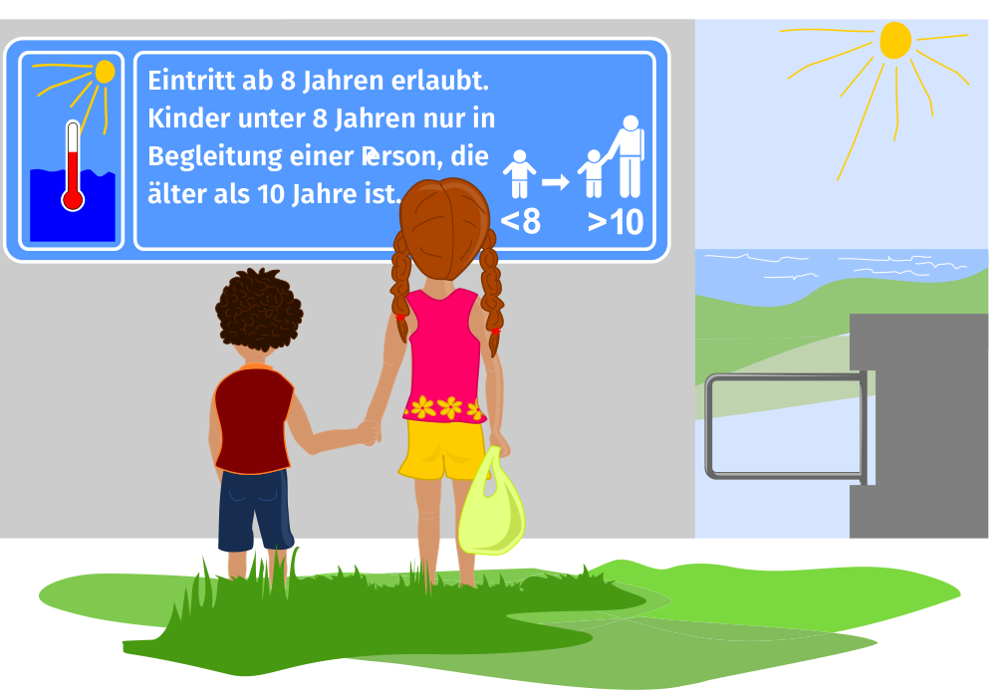

Es ist Sommer! Angela (12 Jahre alt) geht zum Strand. Sie nimmt ihren Bruder Fred mit. Fred ist 6 Jahre alt. Am Eingang zum Strand ist ein Schild:

> Eintritt ab 8 Jahren erlaubt.
> Kinder unter 8 Jahren nur in Begleitung einer Person, die älter als 10 Jahre ist.

**Wer darf auf den Strand?**
