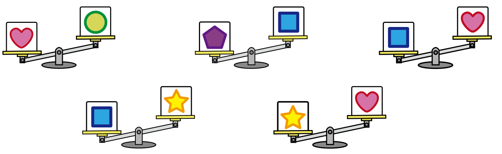

Fünf Kisten sind mit fünf verschiedenen Bildern markiert: Herz, Stern, Fünfeck, Kreis und Quadrat.

Mit einer Waage werden jeweils zwei Kisten verglichen. Zum Beispiel ist die Kiste mit dem Herz schwerer als die Kiste mit dem Kreis.

Insgesamt wird fünf Mal verglichen:

**Welche Kiste ist am schwersten?**
