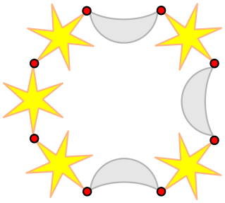

Marie wünscht sich ein Armband aus Monden und Sternen, so wie dieses:

Sie kann aber nicht gut zeichnen und gibt lieber Anweisungen, wie das Armband gemacht werden soll:

1. Verbinde einen Stern und einen Mond zu einem Paar.
2. Mache den ersten Schritt noch zweimal, so dass du am Ende drei Paare hast.
3. Verbinde die drei Paare zu einer Kette.
4. Füge weitere zwei Sterne an einem Ende der Kette an.
5. Verbinde die Enden zu einem Armband.

**Welches Armband kann NICHT nach Maries Anweisungen gemacht werden?**
