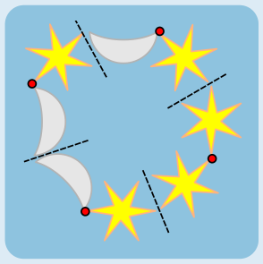
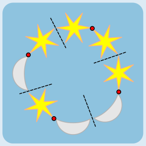
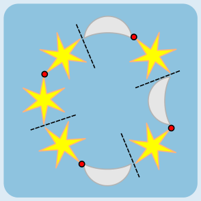

Antwort C ist richtig:

Die Bilder zeigen, dass jedes andere Armband in drei Stern-Mond-Paare und ein an diese drei Paare angefügtes Stern-Stern-Paar zerteilt werden und deshalb nach den Anweisungen gemacht werden kann.

Nach Anweisung 1 muss jeder Mond im Armband neben einem Stern sein. In einem Armband, das nach den Anweisungen gemacht wurde, können deshalb nicht drei Monde hintereinander vorkommen – so wie in Armband C.

## Das ist Informatik!

Maries Anweisungen in dieser Biberaufgabe haben also nicht ein einzelnes Armband beschrieben, sondern viele Armbänder: nämlich die Menge aller Armbänder, die nach den Anweisungen gemacht werden können. Hätte Marie sich in Anweisung 3 nicht auf drei Paare beschränkt, sondern die Anzahl der Paare offen gelassen, wäre diese Menge sogar unendlich groß.

Computer sind nicht unendlich groß; insbesondere ist ihr Speicher begrenzt. Damit sie trotzdem mit potenziell unendlich großen Mengen umgehen können, verwendet die Informatik Methoden, Mengen auf endliche Art und Weise zu beschreiben – wie Maries Anweisungen in dieser Biberaufgabe.

Eine solche Informatik-Methode ist, die Struktur der Elemente einer Menge durch Regeln zu beschreiben. Versuchen wir das einmal mit Maries Armbändern:

- Ein Armband A besteht aus einer Kette K und zwei Sternen S: A → KSS
- Eine Kette K besteht aus drei Paaren P: K → PPP
- Ein Paar P besteht aus einem Stern S und einem Mond M (oder umgekehrt): P → SM, P → MS

Maries Wunscharmband entsteht, wenn man die Regeln so anwendet (→ steht für die Anwendung einer Regel):

A → KSS → PPPSS → MSPPSS → MSMSPSS → MSMSMSSS

Die Regeln beschreiben, wie ein Startsymbol (hier das A für Armband) nach und nach durch andere Symbole ersetzt werden kann, bis nur noch bestimmte Endsymbole (hier S und M für Stern und Mond) vorkommen. Alle Kombinationen von Endsymbolen, die durch Anwendung der Ersetzungsregeln auf das Startsymbol entstehen können, gehören zu der durch die Regeln beschriebenen Menge. In der Informatik heißt eine solche Menge von Ersetzungsregeln mit Start- und Endsymbolen Grammatik, und die durch die Regeln beschriebene Menge heißt Sprache. Solche Regelsysteme erinnern nämlich an natürliche Sprachen, bei denen eine Grammatik beschreibt, wie die Sätze der Sprache aufgebaut werden müssen.
