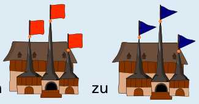

---
answers:
  - [[1, 1, 1], [0, 1, 1], [0, 0, 1], [1, 0, 1], [1, 0, 0], [0, 0, 0], [0, 1, 0], [1, 1, 0]]
  - [[1, 1, 1], [0, 1, 1], [0, 0, 1], [0, 0, 0], [0, 1, 0], [1, 1, 0], [1, 0, 0], [1, 0, 1]]
  - [[1, 1, 1], [0, 1, 1], [0, 1, 0], [1, 1, 0], [1, 0, 0], [0, 0, 0], [0, 0, 1], [1, 0, 1]]
  - [[1, 1, 1], [0, 1, 1], [0, 1, 0], [0, 0, 0], [0, 0, 1], [1, 0, 1], [1, 0, 0], [1, 1, 0]]
  - [[1, 1, 1], [1, 0, 1], [0, 0, 1], [0, 1, 1], [0, 1, 0], [0, 0, 0], [1, 0, 0], [1, 1, 0]]
  - [[1, 1, 1], [1, 0, 1], [0, 0, 1], [0, 0, 0], [1, 0, 0], [1, 1, 0], [0, 1, 0], [0, 1, 1]]
  - [[1, 1, 1], [1, 0, 1], [1, 0, 0], [1, 1, 0], [0, 1, 0], [0, 0, 0], [0, 0, 1], [0, 1, 1]]
  - [[1, 1, 1], [1, 0, 1], [1, 0, 0], [0, 0, 0], [0, 0, 1], [0, 1, 1], [0, 1, 0], [1, 1, 0]]
  - [[1, 1, 1], [1, 1, 0], [1, 0, 0], [1, 0, 1], [0, 0, 1], [0, 0, 0], [0, 1, 0], [0, 1, 1]]
  - [[1, 1, 1], [1, 1, 0], [1, 0, 0], [0, 0, 0], [0, 1, 0], [0, 1, 1], [0, 0, 1], [1, 0, 1]]
  - [[1, 1, 1], [1, 1, 0], [0, 1, 0], [0, 1, 1], [0, 0, 1], [0, 0, 0], [1, 0, 0], [1, 0, 1]]
  - [[1, 1, 1], [1, 1, 0], [0, 1, 0], [0, 0, 0], [1, 0, 0], [1, 0, 1], [0, 0, 1], [0, 1, 1]]
  - [[0, 1, 1], [1, 1, 1], [1, 0, 1], [0, 0, 1], [0, 0, 0], [1, 0, 0], [1, 1, 0], [0, 1, 0]]
  - [[0, 1, 1], [1, 1, 1], [1, 0, 1], [1, 0, 0], [1, 1, 0], [0, 1, 0], [0, 0, 0], [0, 0, 1]]
  - [[0, 1, 1], [1, 1, 1], [1, 1, 0], [1, 0, 0], [1, 0, 1], [0, 0, 1], [0, 0, 0], [0, 1, 0]]
  - [[0, 1, 1], [1, 1, 1], [1, 1, 0], [0, 1, 0], [0, 0, 0], [1, 0, 0], [1, 0, 1], [0, 0, 1]]
  - [[0, 1, 1], [0, 0, 1], [1, 0, 1], [1, 1, 1], [1, 1, 0], [1, 0, 0], [0, 0, 0], [0, 1, 0]]
  - [[0, 1, 1], [0, 0, 1], [1, 0, 1], [1, 0, 0], [0, 0, 0], [0, 1, 0], [1, 1, 0], [1, 1, 1]]
  - [[0, 1, 1], [0, 0, 1], [0, 0, 0], [1, 0, 0], [1, 0, 1], [1, 1, 1], [1, 1, 0], [0, 1, 0]]
  - [[0, 1, 1], [0, 0, 1], [0, 0, 0], [0, 1, 0], [1, 1, 0], [1, 0, 0], [1, 0, 1], [1, 1, 1]]
  - [[0, 1, 1], [0, 1, 0], [1, 1, 0], [1, 1, 1], [1, 0, 1], [1, 0, 0], [0, 0, 0], [0, 0, 1]]
  - [[0, 1, 1], [0, 1, 0], [1, 1, 0], [1, 0, 0], [0, 0, 0], [0, 0, 1], [1, 0, 1], [1, 1, 1]]
  - [[0, 1, 1], [0, 1, 0], [0, 0, 0], [0, 0, 1], [1, 0, 1], [1, 0, 0], [1, 1, 0], [1, 1, 1]]
  - [[0, 1, 1], [0, 1, 0], [0, 0, 0], [1, 0, 0], [1, 1, 0], [1, 1, 1], [1, 0, 1], [0, 0, 1]]
  - [[0, 0, 1], [0, 1, 1], [1, 1, 1], [1, 0, 1], [1, 0, 0], [1, 1, 0], [0, 1, 0], [0, 0, 0]]
  - [[0, 0, 1], [0, 1, 1], [1, 1, 1], [1, 1, 0], [0, 1, 0], [0, 0, 0], [1, 0, 0], [1, 0, 1]]
  - [[0, 0, 1], [0, 1, 1], [0, 1, 0], [1, 1, 0], [1, 1, 1], [1, 0, 1], [1, 0, 0], [0, 0, 0]]
  - [[0, 0, 1], [0, 1, 1], [0, 1, 0], [0, 0, 0], [1, 0, 0], [1, 1, 0], [1, 1, 1], [1, 0, 1]]
  - [[0, 0, 1], [1, 0, 1], [1, 1, 1], [0, 1, 1], [0, 1, 0], [1, 1, 0], [1, 0, 0], [0, 0, 0]]
  - [[0, 0, 1], [1, 0, 1], [1, 1, 1], [1, 1, 0], [1, 0, 0], [0, 0, 0], [0, 1, 0], [0, 1, 1]]
  - [[0, 0, 1], [1, 0, 1], [1, 0, 0], [1, 1, 0], [1, 1, 1], [0, 1, 1], [0, 1, 0], [0, 0, 0]]
  - [[0, 0, 1], [1, 0, 1], [1, 0, 0], [0, 0, 0], [0, 1, 0], [1, 1, 0], [1, 1, 1], [0, 1, 1]]
  - [[0, 0, 1], [0, 0, 0], [1, 0, 0], [1, 0, 1], [1, 1, 1], [1, 1, 0], [0, 1, 0], [0, 1, 1]]
  - [[0, 0, 1], [0, 0, 0], [1, 0, 0], [1, 1, 0], [0, 1, 0], [0, 1, 1], [1, 1, 1], [1, 0, 1]]
  - [[0, 0, 1], [0, 0, 0], [0, 1, 0], [0, 1, 1], [1, 1, 1], [1, 1, 0], [1, 0, 0], [1, 0, 1]]
  - [[0, 0, 1], [0, 0, 0], [0, 1, 0], [1, 1, 0], [1, 0, 0], [1, 0, 1], [1, 1, 1], [0, 1, 1]]
  - [[1, 0, 1], [1, 1, 1], [0, 1, 1], [0, 0, 1], [0, 0, 0], [0, 1, 0], [1, 1, 0], [1, 0, 0]]
  - [[1, 0, 1], [1, 1, 1], [0, 1, 1], [0, 1, 0], [1, 1, 0], [1, 0, 0], [0, 0, 0], [0, 0, 1]]
  - [[1, 0, 1], [1, 1, 1], [1, 1, 0], [1, 0, 0], [0, 0, 0], [0, 1, 0], [0, 1, 1], [0, 0, 1]]
  - [[1, 0, 1], [1, 1, 1], [1, 1, 0], [0, 1, 0], [0, 1, 1], [0, 0, 1], [0, 0, 0], [1, 0, 0]]
  - [[1, 0, 1], [0, 0, 1], [0, 1, 1], [1, 1, 1], [1, 1, 0], [0, 1, 0], [0, 0, 0], [1, 0, 0]]
  - [[1, 0, 1], [0, 0, 1], [0, 1, 1], [0, 1, 0], [0, 0, 0], [1, 0, 0], [1, 1, 0], [1, 1, 1]]
  - [[1, 0, 1], [0, 0, 1], [0, 0, 0], [1, 0, 0], [1, 1, 0], [0, 1, 0], [0, 1, 1], [1, 1, 1]]
  - [[1, 0, 1], [0, 0, 1], [0, 0, 0], [0, 1, 0], [0, 1, 1], [1, 1, 1], [1, 1, 0], [1, 0, 0]]
  - [[1, 0, 1], [1, 0, 0], [1, 1, 0], [1, 1, 1], [0, 1, 1], [0, 1, 0], [0, 0, 0], [0, 0, 1]]
  - [[1, 0, 1], [1, 0, 0], [1, 1, 0], [0, 1, 0], [0, 0, 0], [0, 0, 1], [0, 1, 1], [1, 1, 1]]
  - [[1, 0, 1], [1, 0, 0], [0, 0, 0], [0, 0, 1], [0, 1, 1], [0, 1, 0], [1, 1, 0], [1, 1, 1]]
  - [[1, 0, 1], [1, 0, 0], [0, 0, 0], [0, 1, 0], [1, 1, 0], [1, 1, 1], [0, 1, 1], [0, 0, 1]]
  - [[1, 0, 0], [1, 0, 1], [1, 1, 1], [0, 1, 1], [0, 0, 1], [0, 0, 0], [0, 1, 0], [1, 1, 0]]
  - [[1, 0, 0], [1, 0, 1], [1, 1, 1], [1, 1, 0], [0, 1, 0], [0, 1, 1], [0, 0, 1], [0, 0, 0]]
  - [[1, 0, 0], [1, 0, 1], [0, 0, 1], [0, 1, 1], [1, 1, 1], [1, 1, 0], [0, 1, 0], [0, 0, 0]]
  - [[1, 0, 0], [1, 0, 1], [0, 0, 1], [0, 0, 0], [0, 1, 0], [0, 1, 1], [1, 1, 1], [1, 1, 0]]
  - [[1, 0, 0], [1, 1, 0], [1, 1, 1], [0, 1, 1], [0, 1, 0], [0, 0, 0], [0, 0, 1], [1, 0, 1]]
  - [[1, 0, 0], [1, 1, 0], [1, 1, 1], [1, 0, 1], [0, 0, 1], [0, 1, 1], [0, 1, 0], [0, 0, 0]]
  - [[1, 0, 0], [1, 1, 0], [0, 1, 0], [0, 1, 1], [1, 1, 1], [1, 0, 1], [0, 0, 1], [0, 0, 0]]
  - [[1, 0, 0], [1, 1, 0], [0, 1, 0], [0, 0, 0], [0, 0, 1], [0, 1, 1], [1, 1, 1], [1, 0, 1]]
  - [[1, 0, 0], [0, 0, 0], [0, 0, 1], [0, 1, 1], [0, 1, 0], [1, 1, 0], [1, 1, 1], [1, 0, 1]]
  - [[1, 0, 0], [0, 0, 0], [0, 0, 1], [1, 0, 1], [1, 1, 1], [0, 1, 1], [0, 1, 0], [1, 1, 0]]
  - [[1, 0, 0], [0, 0, 0], [0, 1, 0], [0, 1, 1], [0, 0, 1], [1, 0, 1], [1, 1, 1], [1, 1, 0]]
  - [[1, 0, 0], [0, 0, 0], [0, 1, 0], [1, 1, 0], [1, 1, 1], [0, 1, 1], [0, 0, 1], [1, 0, 1]]
  - [[1, 1, 0], [1, 1, 1], [0, 1, 1], [0, 0, 1], [1, 0, 1], [1, 0, 0], [0, 0, 0], [0, 1, 0]]
  - [[1, 1, 0], [1, 1, 1], [0, 1, 1], [0, 1, 0], [0, 0, 0], [0, 0, 1], [1, 0, 1], [1, 0, 0]]
  - [[1, 1, 0], [1, 1, 1], [1, 0, 1], [0, 0, 1], [0, 1, 1], [0, 1, 0], [0, 0, 0], [1, 0, 0]]
  - [[1, 1, 0], [1, 1, 1], [1, 0, 1], [1, 0, 0], [0, 0, 0], [0, 0, 1], [0, 1, 1], [0, 1, 0]]
  - [[1, 1, 0], [1, 0, 0], [1, 0, 1], [1, 1, 1], [0, 1, 1], [0, 0, 1], [0, 0, 0], [0, 1, 0]]
  - [[1, 1, 0], [1, 0, 0], [1, 0, 1], [0, 0, 1], [0, 0, 0], [0, 1, 0], [0, 1, 1], [1, 1, 1]]
  - [[1, 1, 0], [1, 0, 0], [0, 0, 0], [0, 0, 1], [1, 0, 1], [1, 1, 1], [0, 1, 1], [0, 1, 0]]
  - [[1, 1, 0], [1, 0, 0], [0, 0, 0], [0, 1, 0], [0, 1, 1], [0, 0, 1], [1, 0, 1], [1, 1, 1]]
  - [[1, 1, 0], [0, 1, 0], [0, 1, 1], [1, 1, 1], [1, 0, 1], [0, 0, 1], [0, 0, 0], [1, 0, 0]]
  - [[1, 1, 0], [0, 1, 0], [0, 1, 1], [0, 0, 1], [0, 0, 0], [1, 0, 0], [1, 0, 1], [1, 1, 1]]
  - [[1, 1, 0], [0, 1, 0], [0, 0, 0], [0, 0, 1], [0, 1, 1], [1, 1, 1], [1, 0, 1], [1, 0, 0]]
  - [[1, 1, 0], [0, 1, 0], [0, 0, 0], [1, 0, 0], [1, 0, 1], [0, 0, 1], [0, 1, 1], [1, 1, 1]]
  - [[0, 1, 0], [0, 1, 1], [1, 1, 1], [1, 0, 1], [0, 0, 1], [0, 0, 0], [1, 0, 0], [1, 1, 0]]
  - [[0, 1, 0], [0, 1, 1], [1, 1, 1], [1, 1, 0], [1, 0, 0], [1, 0, 1], [0, 0, 1], [0, 0, 0]]
  - [[0, 1, 0], [0, 1, 1], [0, 0, 1], [1, 0, 1], [1, 1, 1], [1, 1, 0], [1, 0, 0], [0, 0, 0]]
  - [[0, 1, 0], [0, 1, 1], [0, 0, 1], [0, 0, 0], [1, 0, 0], [1, 0, 1], [1, 1, 1], [1, 1, 0]]
  - [[0, 1, 0], [1, 1, 0], [1, 1, 1], [0, 1, 1], [0, 0, 1], [1, 0, 1], [1, 0, 0], [0, 0, 0]]
  - [[0, 1, 0], [1, 1, 0], [1, 1, 1], [1, 0, 1], [1, 0, 0], [0, 0, 0], [0, 0, 1], [0, 1, 1]]
  - [[0, 1, 0], [1, 1, 0], [1, 0, 0], [1, 0, 1], [1, 1, 1], [0, 1, 1], [0, 0, 1], [0, 0, 0]]
  - [[0, 1, 0], [1, 1, 0], [1, 0, 0], [0, 0, 0], [0, 0, 1], [1, 0, 1], [1, 1, 1], [0, 1, 1]]
  - [[0, 1, 0], [0, 0, 0], [0, 0, 1], [0, 1, 1], [1, 1, 1], [1, 0, 1], [1, 0, 0], [1, 1, 0]]
  - [[0, 1, 0], [0, 0, 0], [0, 0, 1], [1, 0, 1], [1, 0, 0], [1, 1, 0], [1, 1, 1], [0, 1, 1]]
  - [[0, 1, 0], [0, 0, 0], [1, 0, 0], [1, 0, 1], [0, 0, 1], [0, 1, 1], [1, 1, 1], [1, 1, 0]]
  - [[0, 1, 0], [0, 0, 0], [1, 0, 0], [1, 1, 0], [1, 1, 1], [1, 0, 1], [0, 0, 1], [0, 1, 1]]
  - [[0, 0, 0], [0, 0, 1], [0, 1, 1], [1, 1, 1], [1, 0, 1], [1, 0, 0], [1, 1, 0], [0, 1, 0]]
  - [[0, 0, 0], [0, 0, 1], [0, 1, 1], [0, 1, 0], [1, 1, 0], [1, 1, 1], [1, 0, 1], [1, 0, 0]]
  - [[0, 0, 0], [0, 0, 1], [1, 0, 1], [1, 1, 1], [0, 1, 1], [0, 1, 0], [1, 1, 0], [1, 0, 0]]
  - [[0, 0, 0], [0, 0, 1], [1, 0, 1], [1, 0, 0], [1, 1, 0], [1, 1, 1], [0, 1, 1], [0, 1, 0]]
  - [[0, 0, 0], [1, 0, 0], [1, 0, 1], [1, 1, 1], [1, 1, 0], [0, 1, 0], [0, 1, 1], [0, 0, 1]]
  - [[0, 0, 0], [1, 0, 0], [1, 0, 1], [0, 0, 1], [0, 1, 1], [1, 1, 1], [1, 1, 0], [0, 1, 0]]
  - [[0, 0, 0], [1, 0, 0], [1, 1, 0], [1, 1, 1], [1, 0, 1], [0, 0, 1], [0, 1, 1], [0, 1, 0]]
  - [[0, 0, 0], [1, 0, 0], [1, 1, 0], [0, 1, 0], [0, 1, 1], [1, 1, 1], [1, 0, 1], [0, 0, 1]]
  - [[0, 0, 0], [0, 1, 0], [0, 1, 1], [1, 1, 1], [1, 1, 0], [1, 0, 0], [1, 0, 1], [0, 0, 1]]
  - [[0, 0, 0], [0, 1, 0], [0, 1, 1], [0, 0, 1], [1, 0, 1], [1, 1, 1], [1, 1, 0], [1, 0, 0]]
  - [[0, 0, 0], [0, 1, 0], [1, 1, 0], [1, 1, 1], [0, 1, 1], [0, 0, 1], [1, 0, 1], [1, 0, 0]]
  - [[0, 0, 0], [0, 1, 0], [1, 1, 0], [1, 0, 0], [1, 0, 1], [1, 1, 1], [0, 1, 1], [0, 0, 1]]
---
Eine Lösung kann man durch geschicktes Ausprobieren finden. Die einzige „Problemstelle“ in der Flaggenanzeige ist der Übergang von 111 (blau, blau, blau) zu 000 (rot, rot, rot) um Mitternacht. Wenn man 000 (21–24 Uhr) mit 110 (15–18 Uhr) tauscht, ist der Wunsch der Biber erfüllt:

Systematisch findet man eine Lösung mit der folgenden Methode: Die acht Flaggenbilder kann man mit dreistelligen Binärzahlen beschreiben; 0 steht für ein rotes Quadrat und 1 für ein blaues Dreieck: 000, 001, 010, 011, 100, 101, 110, 111.

Wir müssen also für diese Binärzahlen eine Anordnung finden, bei der sich zwei beliebige benachbarte Zahlen sowie die erste und die letzte Zahl jeweils nur in einer Stelle unterscheiden. Wir betrachten zuerst nur die 000. Die schreiben wir zweimal hintereinander, ändern beim zweiten Mal aber die erste Stelle (von rechts) von 0 zu 1. So erhalten wir die Anordnung 000, 001; sie erfüllt die Bedingung. Jetzt schreiben wir dahinter diese beiden Zahlen nochmals, aber in umgekehrter Reihenfolge (also 001, 000) und ändern nun die zweite Stelle von 0 zu 1 (also 011, 010). So erhalten wir die Zahlenfolge 000, 001, 011, 010, die ebenfalls die Bedingung erfüllt. Diese neue Zahlenfolge schreiben wir jetzt gleich nochmals und wieder umgekehrt dahinter und ändern nun überall die dritte Stelle von 0 zu 1. So erhalten wir diese Anordnung der acht dreistelligen Binärzahlen: 000, 001, 011, 010, 110, 111, 101, 100. Sie erfüllt die Bedingung.

Diese Methode (Spiegeln der bestehenden Zahlenfolge und Ändern der nächsthöheren Stelle von 0 zu 1) kann man beliebig lange fortsetzen, um solche Anordnungen für beliebig viele statt nur drei Flaggen bzw. Bits zu erhalten.

Hinweis: Es gibt mehrere richtige Anordnungen; alle werden akzeptiert.

## Das ist Informatik!

Eine Anordnung von Binärzahlen, welche die „Bequemlichkeits-Bedingung“ dieser Biberaufgabe erfüllt, heißt Gray-Code, benannt nach dem Erfinder Frank Gray. Generell kann ein Gray-Code dazu eingesetzt werden, die Übertragung oder Messung binär kodierter Information abzusichern: Wenn benachbarte Werte sich nur in einem Bit unterscheiden, führen kleine Fehler oder Ungenauigkeiten auch nur zu einem leicht falschen Wert.

Ein gutes Beispiel ist das Messen der Winkelposition einer Drehscheibe. Mit Hilfe eines sechsstelligen Binärcodes lassen sich 64 Winkelpositionen unterscheiden. Wenn die Sensoren genau auf der Grenze zwischen zwei Code-Wörtern stehen, sind bei einem Gray-Code nur zwei benachbarte Zahlen möglich, die sich nur leicht vom wirklichen Winkel unterscheiden. Beim normalen Binärcode folgen z. B. die Code-Wörter 111010 und 111001 aufeinander, die sich in zwei Bits unterscheiden; dann sind vier verschiedene Werte möglich. Im schlimmsten Fall befänden sich die Sensoren an der Grenze zwischen 000000 und 111111. Dann wären 64 verschiedene Werte möglich, und die Winkelmessung wird unbrauchbar.
