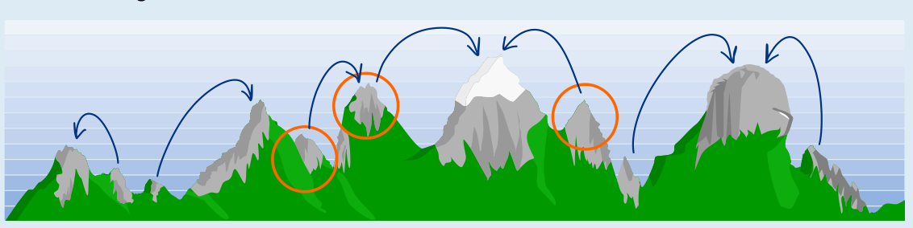

Die Pfeile zeigen, ob Greta von einem Gipfel aus weiter klettert und wohin. Von den drei eingekreisten Gipfeln aus erreicht Greta also den höchsten Gipfel, entlang der Pfeile.

## Das ist Informatik!

Greta möchte hoch hinaus! Dabei verfolgt sie dieses Prinzip: In jeder Situation (also auf jedem Gipfel) macht sie den nächsten Schritt, der sie möglichst weit nach oben bringt. Wie diese Biberaufgabe zeigt, kommt sie dabei aber nicht immer auf den insgesamt höchsten Gipfel, sondern bleibt auf Gipfeln stecken, die nur in ihrer Umgebung, also lokal, die höchsten sind.

Gretas Prinzip ist in der Informatik als „greedy“ (deutsch: gierig) bekannt. Auf der Suche nach einem optimalen Ergebnis machen gierige Algorithmen immer den nächstbesten Schritt und laufen deshalb Gefahr, ein nur lokales Optimum zu finden und ein insgesamt optimales Ergebnis zu verpassen. Ein Beispiel ist der so genannte Bergsteigeralgorithmus, englisch auch „hill climbing“ genannt, der ganz offensichtlich die Idee zu dieser Biberaufgabe geliefert hat. Algorithmen nach dem Prinzip „greedy“ sind aber einfach zu realisieren und deshalb beliebt. Man kann sie gut verwenden, wenn man ausschließen kann, dass es lokale Optima gibt, oder wenn man mit vielleicht recht guten aber nicht optimalen Ergebnissen zufrieden ist. In der Informatik ist gut bekannt, unter welchen Bedingungen gierige Algorithmen wie gut funktionieren.
