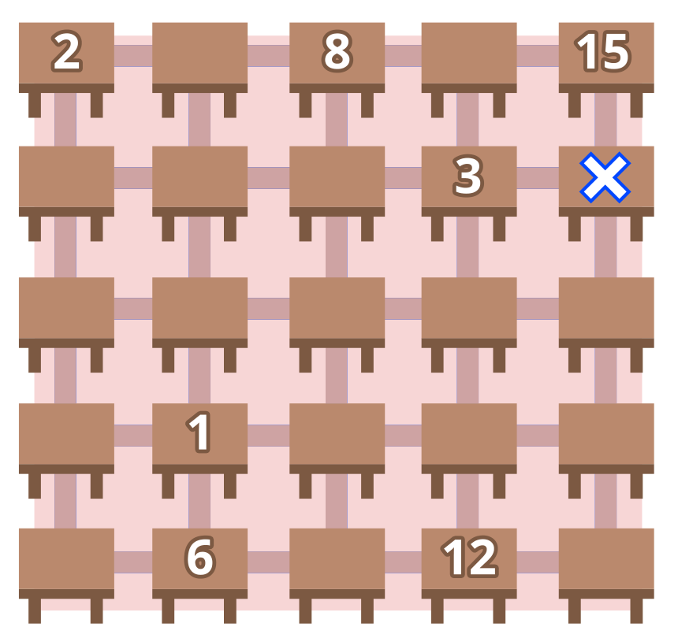

Die Informatik-Lehrerin hat für den Unterrichtsbeginn ein Bewegungsspiel eingeführt: den Biber-Parcours. Das Spiel geht so:

Auf dem Tischplan des Klassenraums sind sieben Tische mit Zahlen markiert. Auf jedem dieser Tische liegt ein kleiner Gegenstand.

Du sollst innerhalb von 16 Sekunden möglichst viele Gegenstände zum Lehrertisch (der Tisch mit dem weißen Kreuz, zweite Reihe von oben ganz rechts) bringen.

Du kannst an einem beliebigen Tisch starten und dich dann entlang der Linien von Tisch zu Tisch bewegen. Du darfst jede Linie nur einmal entlang gehen. Du brauchst genau 1 Sekunde, um von einem Tisch zum nächsten zu gehen und, falls vorhanden, einen Gegenstand zu nehmen.

Die Zahl auf einem Tisch sagt dir, nach wie vielen Sekunden du frühestens bei diesem Tisch sein darfst.

Hier ist der Tischplan. Je zwei benachbarte Tische sind durch eine Linie verbunden.

**Wie viele Gegenstände kannst du innerhalb von 16 Sekunden höchstens zum Lehrertisch bringen?**
