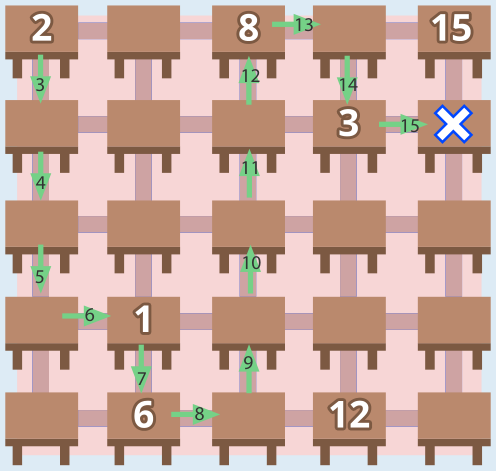

5 ist die richtige Antwort:

Das Bild zeigt einen Weg durch den Klassenraum, auf dem innerhalb von 15 Sekunden (und damit auch innerhalb von 16 Sekunden) fünf Gegenstände zum Lehrertisch gebracht werden können. Ein Pfeil steht für den Gang von einem Tisch zum nächsten. Die Zahl in der Pfeilspitze sagt, nach wie vielen Sekunden man frühestens beim nächsten Tisch sein kann. Damit man bei einem Tisch nicht warten muss, muss die Zahl in der Pfeilspitze größer oder gleich der Zahl auf dem Tisch sein. Es gibt noch einige andere Wege durch den Klassenraum, auf denen man auch fünf Gegenstände zum Lehrertisch bringen kann.

Im Weiteren heißen die Gegenstände einfach so wie die Zahl auf ihrem Tisch. Es ist nicht möglich, alle sieben Gegenstände innerhalb von 16 Sekunden zum Lehrertisch zu bringen. Frühestens nach 12 Sekunden darf man bei Gegenstand 12 ankommen. Von dort aus kann man frühestens nach weiteren 5 Sekunden bei Gegenstand 15 sein – zu spät, um auch diesen Gegenstand mitbringen zu können. Ist man zuerst (nach 15 Sekunden) bei Gegenstand 15, hat man erst recht keine Zeit, um auch Gegenstand 12 mitzubringen. Die Gegenstände 12 und 15 schließen sich also aus. Kann man denn sechs Gegenstände rechtzeitig zum Lehrertisch bringen? Dazu müsste man entweder auf 12 oder auf 15 verzichten. Wenn man auf 15 verzichtet, müsste man 8 und 12 mitbringen. Das geht aber nicht. Von 8 aus ist man frühestens nach 13 Sekunden bei 12 und schafft es dann nicht mehr rechtzeitig bis zum Lehrertisch. Also muss man auf 12 verzichten. Jetzt kann man sich überlegen, dass man oben rechts die Gegenstände 3, 8 und 15 nur dann rechtzeitig mitbringen kann, wenn man nach 11 Sekunden bei 8 ist. Auf insgesamt sechs Gegenstände kommt man dann wiederum nur, wenn man vorher schon 1, 2 und 6 genommen hat. Man kann durchaus nach 11 Sekunden bei 8 sein, nämlich wenn man nach 6 Sekunden bei 6 ist – und vorher mindestens Gegenstand 2 genommen hat. Denn von 6 aus kann man entweder auf direktem Wege oder über Gegenstand 1 in 5 Sekunden bei 8 sein. Aber wenn man zuerst Gegenstand 2 nimmt, ist man erst nach 7 Sekunden bei 6 und nach 12 Sekunden bei 8. Nimmt man also zuerst 1, 2 und 6 und danach 8, 3 und 15, dauert das eine Sekunde zu lange. Andere Wege mit sechs Gegenständen sind sogar noch länger. Man kann also nur fünf Gegenstände innerhalb von 16 Sekunden zum Lehrertisch bringen.

## Das ist Informatik!

Wenn man eine Aufgabe auf eine bestmögliche Weise lösen soll, hat man es mit einem Optimierungsproblem zu tun. In dieser Biberaufgabe gibt es viele Lösungen der Aufgabe, Gegenstände unter den gegebenen Bedingungen zum Lehrertisch zu bringen. Optimal ist darunter, laut Fragestellung, eine Lösung mit möglichst vielen Gegenständen. Die Anzahl der Gegenstände bestimmt also, wie gut eine Lösung ist, und liefert damit die Optimierungsfunktion (siehe auch die Aufgabe „Blumenkasten“ in diesem Biberheft). Während hier nur nach dem optimalen Wert dieser Funktion gefragt wurde, ist es häufig auch wichtig, mindestens eine Lösung anzugeben, die diesen Funktionswert hat – eine optimale Lösung also.

Optimierungsprobleme stellen sich in vielen Lebensbereichen: Wie kommt man am schnellsten von der Wohnung zur Schule? Welche Route soll der Paketwagen nehmen, damit er in der vorgesehenen Zeit möglichst viele Pakete ausliefern kann? Es gibt viele Optimierungsprobleme, bei denen es schwierig ist, in allen Fällen die beste(n) Lösung(en) zu finden. Wenn sich die Lösung aus einzelnen Schritten zusammensetzt (wie hier aus den Wegen zwischen den einzelnen Gegenständen), kann man es mit der in der Informatik als „backtracking“ bekannten Methode versuchen: An Stellen, an denen es mehrere Möglichkeiten gibt, den Lösungsversuch um einen Schritt zu ergänzen, wählt man eine davon aus. Das macht man so lange, bis man entweder eine Lösung hat (hier: innerhalb von 16 Sekunden am Lehrertisch angekommen ist) oder sicher ist, dass man mit den bisher gewählten Schritten keine Lösung finden kann oder nur eine, die schlechter ist als die bisher beste. Dann geht man auf der „Spur“ (engl.: track) des aktuellen Lösungsversuchs so lange zurück (engl.: back), bis man an einer Auswahlstelle eine andere Möglichkeit wählen kann.
