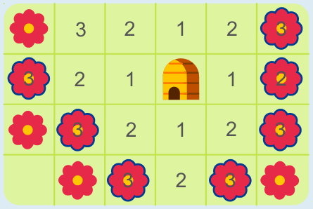

Das Bild zeigt, zu welchen Feldern die Bienen fliegen können, wenn sie 1 Feld, 2 Felder oder 3 Felder weit fliegen können. Die Blumen mit einer Biene in der Mitte können sie dabei also erreichen. Diese Blumen sind für die Bienen höchstens 3 Felder weit vom Bienenstock entfernt.

Um zu den anderen Blumen fliegen zu können, müssten die Bienen 4 Felder weit fliegen können. Das können sie aber nicht.

## Das ist Informatik!

Diese Biberaufgabe kann gelöst werden, indem vom Bienenstock aus der Abstand zu allen Feldern bestimmt wird. Dann kennt man am Ende auch den Abstand zu allen Blumen. Um bei der Bestimmung des Abstands nicht immer wieder neu beim Bienenstock anfangen zu müssen, kann man schrittweise vorgehen: Erst bestimmt man alle Felder mit Abstand 1 zum Bienenstock. Die Felder mit Abstand 2 zum Bienenstock sind dann alle Felder, die zu den „Abstand-1-Feldern“ den Abstand 1 haben – und nicht schon selbst zu den „Abstand-1-Feldern“ des Bienenstocks gehören. Die Felder mit Abstand 3 werden danach mit Hilfe der Felder mit Abstand 2 gefunden, und so könnte man weiter machen, wenn die Bienen weiter fliegen könnten.

Ein Verfahren, das Ergebnisse mit Hilfe vorher gefundener Ergebnisse berechnet, folgt einer Idee, die in der Informatik als „Dynamische Programmierung“ bekannt ist. Sie wird häufig verwendet, unter anderem bei der Bestimmung von kürzesten Wegen zwischen zwei Orten.
