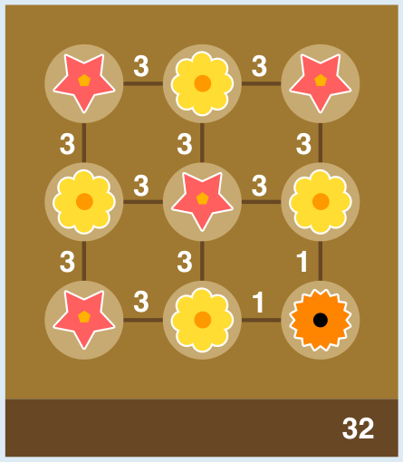

Peter vergibt Punkte für benachbarte Blumen-Paare. Jede Linie im Blumenkasten-Bild steht für ein solches Paar. Eine Bepflanzung bekommt möglichst viele Punkte (und ist dann perfekt), wenn so viele Paare wie möglich aus einer roten und einer gelben Blume bestehen. Es muss aber auch mindestens eine orange Blume vorkommen. Um auch mit einer orangen Blume Punkte zu machen, muss sie mit gelben Blumen Paare bilden. Es sollte aber nur so wenige orange-gelbe Paare geben wie möglich, damit so viele Linien bzw. Paare für die Kombination rot-gelb übrig bleiben.

Das kann man erreichen, wenn man eine einzige orange Blume in eine Ecke platziert – egal in welche. Dann kann sie nur an zwei Paaren beteiligt sein; weniger geht nicht. Neben die orange Blume werden dann gelbe Blumen gesetzt und dann abwechselnd rote und gelbe, wie im Bild. Diese Bepflanzung ist perfekt, denn mehr Punkte kann eine Bepflanzung nicht bekommen.

## Das ist Informatik!

Das Bestreben nach *Optimierung* hat Menschen schon immer ausgezeichnet: der Wunsch, für ein Problem nicht nur irgendeine Lösung zu finden, sondern die beste. Optimierung ist alltäglich: Wer einen bestimmten Computer kaufen will, sucht nach dem Angebot mit dem niedrigsten Preis. Wer von A nach B reisen will, möchte nicht irgendeine Route nehmen, sondern die günstigste. Aber was bedeutet „günstig“ in diesem Fall: Soll die Route möglichst geringe Kosten verursachen, eine möglichst geringe Länge in km haben oder möglichst wenig Zeit in Anspruch nehmen?

Wenn man ein Optimierungsproblem lösen will, benötigt man also nicht nur die Kenntnis, wie eine Lösung des Problems überhaupt aussieht. Man braucht auch eine Funktion, die den Wert einer Lösung berechnen kann. Eine optimale Lösung (oder auch: ein Optimum) ist dann eine Lösung mit dem höchsten Wert – oder mit dem niedrigsten Wert, je nach Funktion. In dieser Biberaufgabe ist Peters Methode zur Berechnung eines Punktwerts für ein Blumenarrangement eine solche Optimierungsfunktion.

In der Mathematik wird Optimierung seit Jahrhunderten untersucht. In der Informatik wurde viel Sorgfalt darauf verwandt, mathematische Optimierungsmethoden als Algorithmen zu implementieren: Computer können für die Optimierung bei groß angelegten Problemen eingesetzt werden, bei denen Menschen keinen Erfolg hätten. Es ist bekannt, dass viele Optimierungsprobleme sehr schwer zu lösen sind. Informatikerinnen und Informatiker haben deshalb für solche Probleme Methoden (sogenannte Heuristiken) erfunden und untersucht, die nicht immer das Optimum, aber Lösungen nahe am Optimum finden.
