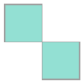
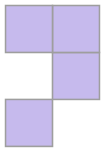
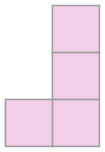

Bominos sind 2D-Figuren. Ein Bomino besteht aus farbigen Quadraten, die in einem Raster liegen. Die Quadrate müssen folgende Bedingungen erfüllen:

1. Jedes Quadrat berührt mindestens ein anderes Quadrat (oben, unten, links, rechts oder diagonal).
2. Für mindestens ein Paar von Quadraten des Bominos gilt:
   - Die beiden Quadrate berühren sich diagonal.
   - Kein weiteres Quadrat des Bominos berührt gleichzeitig diese beiden Quadrate.

Ein Bomino mit n Quadraten heißt auch n-Bomino. Einige Beispiele:

Dies ist das einzig mögliche Bomino aus 2 Quadraten (also: 2-Bomino).

 

Die linke Figur ist ein 4-Bomino. Die rechte Figur ist kein Bomino; Bedingung 2 ist nicht erfüllt.

Zwei Bominos gelten als gleich, wenn das eine durch Drehen oder Spiegeln (oder beides) aus dem anderen entsteht.

**Es gibt drei verschiedene 3-Bominos. Zeichne sie in die Raster.** Jedes 3-Bomino passt in ein Raster.
