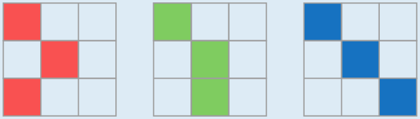

Dies sind die drei verschiedenen 3-Bominos:

So sind sie entstanden: Jedes Bomino muss das oben gezeigte 2-Bomino enthalten, also ein Paar von Quadraten, die sich diagonal berühren, aber von keinem weiteren Quadrat gleichzeitig berührt werden. Deshalb kann zunächst das 2-Bomino wie in der Aufgabe gezeigt in alle drei Raster gezeichnet werden, zum Beispiel oben links. Das dritte Quadrat darf nur eines der ersten beiden berühren. Wir wählen das untere, in der Mitte des Rasters, und fügen das dritte Quadrat daran jeweils an einer anderen Position an, in der unteren Zeile: links, Mitte und rechts.

Es ist egal, ob man das 2-Bomino anders oder an anderer Position ins Raster malt oder ob man das dritte Quadrat an das andere Quadrat des 2-Bomino oder auf andere Weise anfügt (z. B. in der rechten Spalte): Alle resultierenden Figuren entstehen durch Drehung oder Spiegelung aus einer der oben gezeigten Figuren, sind also nicht von ihnen verschieden.

## Das ist Informatik!

Die Bominos in dieser Biberaufgabe werden durch eine genaue Beschreibung ihrer Eigenschaften eingeführt. In der Mathematik nennt man das eine *Definition*, in der Informatik oft auch eine *deklarative* Beschreibung. Die Definition einer Art von Objekten (hier: der Bominos) anhand ihrer grundlegenden Eigenschaften ist Voraussetzung dafür, diese Eigenschaften genauer zu untersuchen und möglicherweise weitere Eigenschaften der Objekte abzuleiten.

Wenn man aber Objekte einer bestimmten Art konstruieren will oder prüfen will, ob ein gegebenes Objekt zu dieser Art gehört, genügt eine deklarative Beschreibung nicht. Erforderlich ist dann eine *operationale* Beschreibung oder auch eine Operationalisierung der Beschreibung, z. B. als Computerprogramm, das die oben genannte Konstruktions- oder Prüfungsaufgabe erledigt.

Ein Beispiel: Eine formale Grammatik beschreibt deklarativ, wie gültige Programme einer Programmiersprache aufgebaut sein müssen. Ein Compiler für diese Programmiersprache ist eine Operationalisierung dieser Beschreibung und prüft (unter anderem), ob ein gegebener Quelltext ein gültiges Programm dieser Sprache ist.

Es ist häufig schwierig, eine deklarative Beschreibung zu operationalisieren. In der Informatik wurden deshalb verschiedene Methoden entwickelt, mit denen deklarative Beschreibungen automatisch in operationale Beschreibungen übersetzt werden können.

Übrigens: Bominos sind eine besondere Biber-Variante der unter anderem aus dem Spiel Tetris bekannten Polyominos. Grob gesagt sind n-Bominos alle n-Pseudo-Polyominos ohne alle n-Polyominos.
