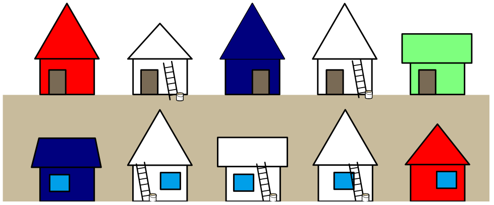

An einer Straße sollen alle Häuser bunt angestrichen werden: in Rot, Blau oder Grün. Damit es nicht langweilig aussieht, gibt es diese Regeln:

- Zwei Häuser, die auf einer Straßenseite direkt nebeneinander stehen, dürfen nicht dieselbe Farbe haben.
- Zwei Häuser, die sich auf zwei Straßenseiten direkt gegenüber stehen, dürfen nicht dieselbe Farbe haben.

Einige Häuser sind schon fertig.

Im Raster steht die obere Zeile für die obere Straßenseite und die untere Zeile für die untere. Die fertigen Häuser sind festgelegt. Die Farben zum Auswählen sind von links nach rechts: Weiß, Rot, Blau, Grün.

**Streiche auch die weißen Häuser nach den Regeln an!**
