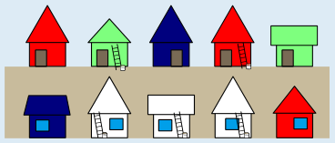
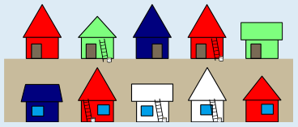
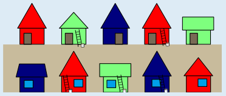

Die Farben der weißen Häuser lassen sich schrittweise bestimmen. Beide Häuser auf der oberen Straßenseite stehen direkt neben Häusern mit verschiedenen Farben. Für den Anstrich der Häuser bleibt also jeweils nur die dritte Farbe übrig, einmal Grün und einmal Rot:

Auf der unteren Straßenseite steht nun das linke weiße Haus neben einem blauen Haus und einem grünen Haus gegenüber. Es muss also rot angestrichen werden.

Das weiße Haus rechts daneben steht damit nun neben einem roten Haus und einem blauen Haus gegenüber. Es muss also grün angestrichen werden. Danach steht auch die Farbe des letzten weißen Hauses fest: Blau.

## Das ist Informatik!

Die Häuser dieser Aufgabe und deren direkte Nachbarschaften (sowohl nach links und nach rechts als auch quer über die Straße hinweg) können als ein Graph modelliert werden. Dabei ist jedes Haus ein Knoten (gezeichnet als Kreis), und jede direkte Nachbarschaft ist eine Kante (gezeichnet als Linie). Jeder Knoten ist so gefärbt, wie das zugehörige Haus am Ende angemalt ist.

Die Regeln in dieser Biberaufgabe bewirken, dass in diesem „Häuser-Graph“ zwei Knoten, die durch eine Kante verbunden sind, nicht gleich gefärbt sind. Würde man zwei Kanten hinzufügen, wäre dies nicht mehr möglich, wir bräuchten eine vierte Farbe.

Wie viele Farben braucht man dann höchstens, um in beliebigen Graphen die Knoten so einzufärben, dass zwei benachbarte (also durch eine Kante verbundene) Knoten nicht dieselbe Farbe haben? In der Informatik ist bekannt: Vier Farben genügen, wenn der Graph planar ist, das heißt, wenn er keine Kanten hat, die sich kreuzen. Dieser Satz ist als Vier-Farben-Satz oder auch Vier-Farben-Theorem bekannt.

Es ist nicht einfach einzusehen, dass vier Farben bei allen planaren Graphen ausreichen. Erst 1976 konnten die Mathematiker Kenneth Appel und Wolfgang Haken das beweisen. Dazu haben sie Computer verwendet, um eine Vielzahl von Ausnahmen und Gegenbeispielen zu überprüfen. Andere Menschen können das ohne Computer nicht nachvollziehen. Deshalb gibt es andere Mathematiker, die den Computereinsatz bei diesem Beweis oder allgemein beim Beweisen kritisch sehen.

Der Vier-Farben-Satz wird in vielen Computerprogrammen angewendet: beispielsweise um Flugpläne zu erstellen, bei denen Flugzeuge Korridoren zugeteilt werden, damit sie immer genügend Abstand haben, oder auch um Frequenzbereiche von Sendemasten zuzuteilen, so dass diese sich nicht stören und der Empfang trotz vieler Sendemasten nicht schlechter wird.
