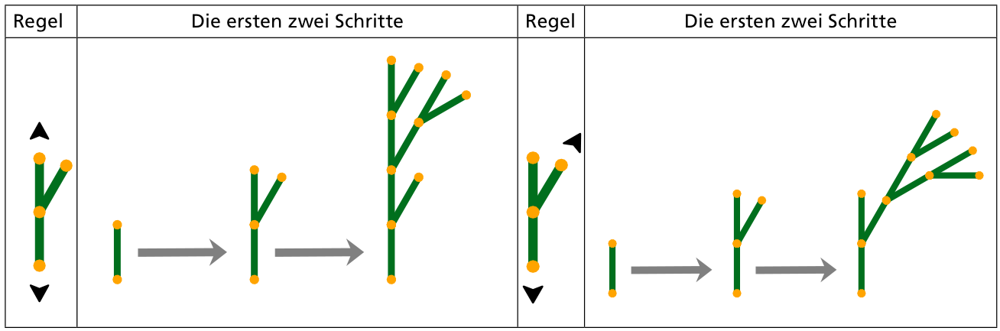
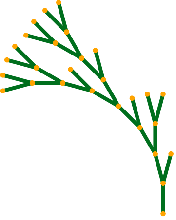

Digitale Bäume wachsen schrittweise, nach vorgegebenen Regeln.

Ein digitaler Baum besteht zuerst aus einem Stück: 

Eine Wachstumsregel gibt an, wie ein Baumstück durch eine Struktur von Stücken ersetzt wird. In jedem Wachstumsschritt wird die Regel gleichzeitig auf jedes Baumstück angewendet. Zwei Beispiele:

Die Pfeilspitzen geben an, wo und in welche Richtung dabei die Strukturen aneinander gesetzt werden.

Hier ist ein digitaler Baum. Er ist in 4 Schritten gewachsen. Unten siehst du verschiedene Wachstumsregeln.

**Nach welcher Regel ist der Baum gewachsen?**
