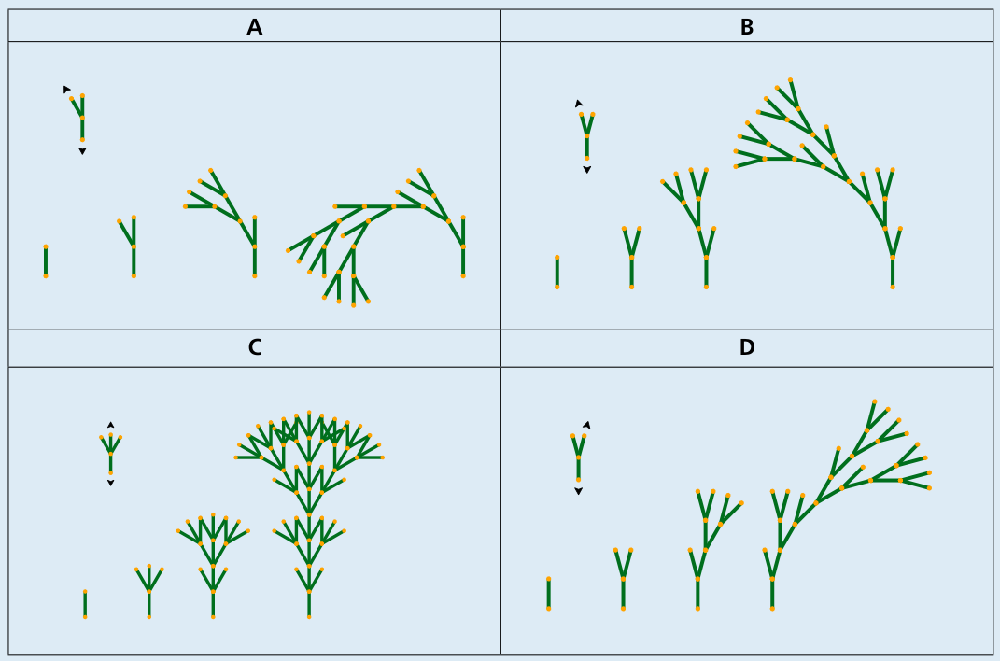

Antwort B ist richtig:

Regel A: Der Rest des Baumes wird stets am nach links zeigenden Zweig angefügt. Der Baum krümmt sich deshalb stark nach links.

Regel B: Der Rest des Baumes wird stets am linken Abzweig angefügt; dieser neigt sich aber weniger stark nach links als der Zweig in Regel A. Der Baum neigt sich deshalb nach links.

Regel C: Der Rest des Baumes wird stets in der Mitte angefügt, in gerader Richtung. Durch die beiden Abzweige links und rechts bildet sich insgesamt eine gleichmäßige, symmetrische Struktur.

Regel D ist die horizontale Spiegelung von Regel B. Der Rest des Baumes wird stets am rechten Abzweig angefügt. Der Baum neigt sich deshalb nach rechts.

Hier sieht man, wie die digitalen Bäume nach den verschiedenen Regeln wachsen.

## Das ist Informatik!

An den digitalen Bäumen in dieser Biberaufgabe kann man sehen, wie durch die wiederholte Anwendung einer einfachen Wachstumsregel in wenigen Schritten komplexe Figuren entstehen können. Diese Idee findet sich in den so genannten „Lindenmayer-Systemen“ wieder, die kurz auch L-Systeme genannt werden. Der Biologe Aristid Lindenmayer hat sie erfunden, um das Wachstum von Pflanzen zu beschreiben.

L-Systeme können relativ einfach in Computerprogramme umgesetzt werden. Deshalb sind sie auch in der Informatik gut bekannt und werden zum Beispiel im Bereich der Computergrafik genutzt, um für Bilder oder auch Filme sehr wirklichkeitsnahe Darstellungen von Pflanzen zu erzeugen. L-Systeme verwenden das Prinzip der Rekursion, um mit einfachen Beschreibungen komplexe Strukturen entstehen zu lassen (siehe auch die Aufgaben „Sierpinski-Dreieck“ und „Zahlenmaschine“ in diesem Biberheft).
