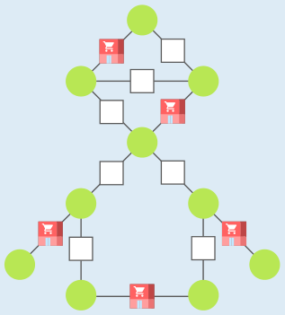
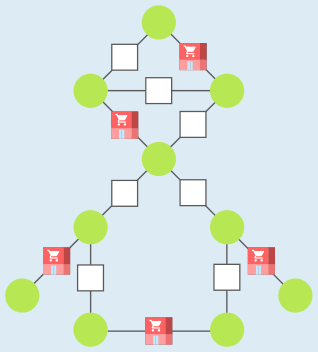

---
answers:
  - [s8, s9, s12, s1, s5]
  - [s8, s9, s12, s2, s4]
---
Wir sagen, dass ein Bauplatz bzw. ein darauf gebautes Geschäft ein Dorf versorgt, wenn der Bauplatz vom Dorf aus direkt erreicht werden kann, ohne durch ein anderes Dorf zu fahren. An den Straßen ganz links und rechts müssen Geschäfte sein, um die Dörfer ganz außen zu versorgen. Um die beiden Dörfer unten zu versorgen, reicht es, wenn dazwischen ein Geschäft gebaut wird. Damit haben wir drei Bauplätze ausgewählt, um die unteren sechs Dörfer zu versorgen.

Weil ein Geschäft höchstens zwei Dörfer versorgen kann, werden mindestens zwei weitere Geschäfte benötigt, um auch die oberen vier Dörfer zu versorgen. Die Bilder zeigen die beiden einzigen Möglichkeiten, die oberen Dörfer mit nur zwei Geschäften zu versorgen. Lässt man nur eines der fünf Geschäfte weg, sind nicht mehr alle Dörfer versorgt. Mit weniger Geschäften geht es also nicht.

## Das ist Informatik!

Die Karte ist ein vereinfachtes Modell der Wirklichkeit und konzentriert sich auf die Information, die für die Auswahl der Bauplätze wichtig ist: Sind zwei Dörfer durch eine Straße verbunden oder nicht? Um Beziehungen zwischen Objekten zu modellieren, werden in der Informatik häufig Graphen verwendet.

Ein Graph besteht aus Knoten und Kanten. Die Knoten stehen für Objekte, und zwischen zwei Knoten gibt es eine Kante, wenn die beiden durch die Knoten modellierten Objekte miteinander in einer bestimmten Beziehung stehen. Die Karte der Dörfer und Straßen ist also die Zeichnung eines Graphen; dessen Knoten (gezeichnet als grüne Punkte) für die Dörfer stehen und dessen Kanten (gezeichnet als Linien) dafür stehen, dass zwei Dörfer durch eine Straße miteinander verbunden sind. Die Modellierung mit Graphen ist in der Informatik sehr verbreitet. Die Informatik kennt nämlich viele Verfahren, um Fragen, die man in Bezug auf Graphen stellen kann, zu beantworten. Die in dieser Biberaufgabe gestellte Frage nach den Bauplätzen kennt die Informatik als „Problem der minimalen Kantenabdeckung“ (englisch: minimum edge cover): Die Herausforderung ist, aus den Kanten eines Graphen möglichst wenige Kanten so auszuwählen, dass von jedem Knoten eine der gewählten Kanten ausgeht. Eine minimale Kantenabdeckung lässt sich auch für große Graphen schnell bestimmen.
