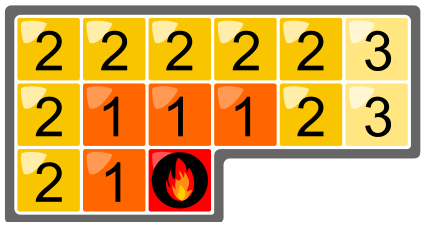

Luis mag es warm im Bad. In sein neues Haus lässt er eine Bodenheizung mit Hotspots einbauen.

Ein Hotspot wird direkt unter einer Fliese montiert. Schaltet man den Hotspot ein, wird diese Fliese sofort warm. Von einer warmen Fliese breitet sich die Wärme in einer Minute auf alle benachbarten Fliesen aus – seitlich und über Eck.

Hier ist ein Beispiel. Die Zahlen sagen für jede Fliese, nach wie vielen Minuten sie warm ist.

Luis kann sich 4 Hotspots leisten. Luis wünscht, dass nach möglichst wenigen Minuten alle Fliesen im Bad warm sind. Die Hotspots werden gleichzeitig angeschaltet.

Hier ist das neue Bad. Tippe die Fliesen an, unter denen du einen Hotspot montieren willst.

**Montiere die 4 Hotspots so, dass Luis' Wunsch erfüllt wird.**
