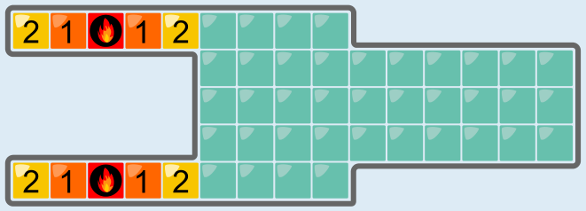
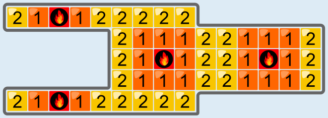
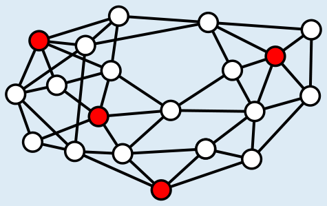

---
answers:
  - [r0c2, r1c12, r2c7, r4c2]
  - [r0c2, r2c7, r2c12, r4c2]
  - [r0c2, r2c7, r3c12, r4c2]
---
Man kann die 4 Hotspots so montieren, dass alle Fliesen des Badezimmers nach 2 Minuten warm sind. Jeder Hotspot kann in der ersten Minute höchstens 9 Fliesen erwärmen, nach 2 Minuten höchstens 25 Fliesen. Vier Hotspots erwärmen in der ersten Minute höchstens 36 Fliesen, in 2 Minuten höchstens 100 Fliesen. Das Badezimmer hat 48 Fliesen. Es ist also unmöglich, mit vier Hotspots alle Fliesen in nur einer Minute zu erwärmen, aber 2 Minuten könnten ausreichen.

Nun müssen die Hotspots so montiert werden, dass alle Fliesen nach 2 Minuten warm sind. Wegen der schlechten Aufteilung des Raumes bietet es sich an, zwei Hotspots so zu montieren, dass die Fliesen in den beiden Gängen nach 2 Minuten warm sind:

Die verbleibenden zwei Hotspots kann man dann so montieren:

Den ganz rechts montierten Hotspot kann man auch eine Fliese darüber oder darunter montieren. Auch dann sind nach 2 Minuten alle Fliesen warm.

## Das ist Informatik!

Das möchte man häufig: mit möglichst wenig Aufwand möglichst viel erreichen. In dieser Biberaufgabe soll mit möglichst wenig Heizungen das Bad möglichst schnell warm werden. Will man ein großes Haus mit WLAN ausstatten, möchte man mit möglichst wenigen Hotspots eine gute Abdeckung aller Räume erzielen. Es gibt noch viele andere Beispiele.

In der Informatik ist ein ähnliches Problem bekannt, nämlich die Bestimmung eines minimalen „Dominating Set“ in einem Graphen. Ein Graph ist eine Struktur aus Knoten und Kanten (das sind Paare von Knoten). Die beiden Knoten einer Kante nennt man auch Nachbarn. Ein Dominating Set (DS) ist eine Teilmenge der Knoten, für die gilt: Jeder andere Knoten muss einen Nachbarn haben, der im Dominating Set enthalten ist. Ein DS ist minimal, wenn es keine kleinere Knoten-Teilmenge gibt, die auch ein DS ist.

Hier ist ein Beispiel-Graph: Die Knoten sind als Kreise, die Kanten als Linien gezeichnet. Jeder weiße Knoten ist Nachbar mindestens eines roten Knotens. Also sind die roten Knoten ein DS, und zwar ein minimaler: Es gibt kein DS mit weniger als vier Knoten.

Die Platzierung der Heizungen kann man als Bestimmen eines minimalen DS verstehen: Die Fliesen sind die Knoten. Zwei Fliesen sind „Heizungs-Nachbarn“ (bilden also eine Kante), wenn das Montieren einer Heizung unter einer Fliese bedeutet, dass die andere nach höchstens zwei Minuten warm ist. Fliesen, die in diesem Graphen ein minimales DS bilden, stellen eine Lösung dieser Biberaufgabe dar.
