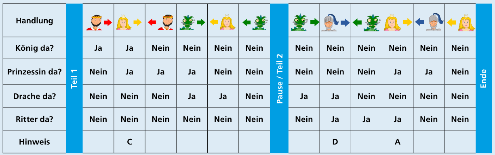

Antwort B ist richtig: König und Drache sind bei der Aufführung nicht gleichzeitig zu sehen.

Man kann sich das schrittweise überlegen. In die Tabelle ist eingetragen, wer zu sehen ist, direkt nachdem eine Figur gekommen oder gegangen ist.

Zwei Figuren sind gleichzeitig zu sehen, wenn in einer Zeile bei beiden Figuren „Ja“ steht.

- Antwort A (Prinzessin und Ritter): Teil 2, Zeile 4
- Antwort C (König und Prinzessin): Teil 1, Zeile 2
- Antwort D (Ritter und Drache): Teil 2, Zeile 2

Nur für Antwort B (König und Drache) gibt es keine Zeile, in der für beide Figuren „Ja“ steht. Also sind König und Drache nicht gleichzeitig zu sehen.

## Das ist Informatik!

Auch wenn man sich anhand der Auftritte und Abgänge der Figuren lebhaft vorstellen kann, was im Theaterstück passiert, ist in dieser Biberaufgabe für jede Figur zu jedem Zeitpunkt nur eine Frage wichtig: befindet sie sich zu diesem Zeitpunkt auf der Bühne oder nicht? Die Antwort auf diese Frage kann nur „ja“ oder „nein“ lauten. Damit entspricht die in der Antwort enthaltene Information einem Bit, der kleinsten Informationseinheit, die in der Informatik bekannt ist. Ein Bit unterscheidet zwischen genau zwei Zuständen oder Werten: ja oder nein, wahr oder falsch, 0 oder 1 – die Namen der Werte spielen genau genommen keine Rolle.

Das Bit ist auch die kleinste Speichereinheit in Computern. Man kann es sehr einfach und günstig realisieren, etwa als ein Schaltelement, in dem eine hohe und eine niedrige Spannung – den zwei möglichen Werten entsprechend – klar unterschieden und für lange Zeit aufrecht erhalten (also gespeichert) werden können. Mit Bits kann man außerdem rechnen, ähnlich wie mit Zahlen; statt Plus und Minus gibt es dafür Operationen wie „UND“ oder „NICHT“. Die können wir gebrauchen, um in dieser Biberaufgabe die richtige Antwort zu finden: Zu keinem Zeitpunkt waren die Bits von König und Drache gleichzeitig wahr, und damit war auch die Bit-Rechnung „König UND Drache“ zu keinem Zeitpunkt wahr.

Auch für Bit-Operationen können einfache und günstige Schaltungen gebaut werden, insbesondere für die kombinierte Operation „NICHT UND“, Englisch kurz mit „NAND“ bezeichnet. Interessant ist, dass alle Berechnungen, die mit Bits überhaupt möglich sind, alleine mit NANDs realisiert werden können; andere Schaltungen braucht man nicht unbedingt. Das ist ein wichtiger Grund für die Bedeutung der Computer: dass sie aus wenigen einfachen, billigen und heutzutage mikroskopisch kleinen Elementen gebaut werden können.
