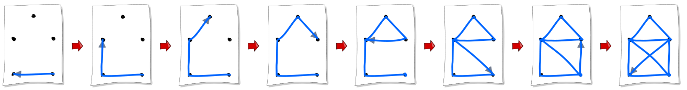

Eine Strichzeichnung besteht aus Punkten und Strichen. Jeder Strich verbindet zwei Punkte miteinander.

Manche Strichzeichnungen können in einem Zug gezeichnet werden. Das heißt:

- Der Stift wird erst vom Blatt abgehoben, wenn die Zeichnung fertig ist.
- Jeder Strich wird nur einmal gezeichnet.

Ein Beispiel:

**Welche dieser Strichzeichnungen kann in einem Zug gezeichnet werden?**
