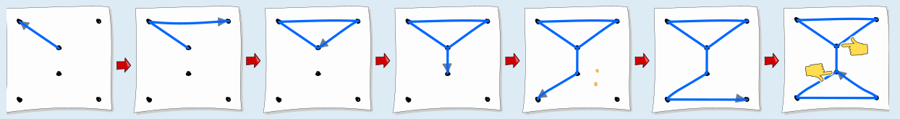
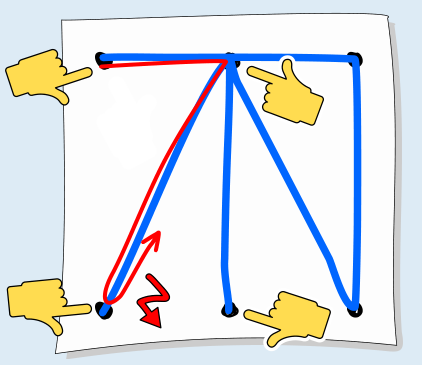
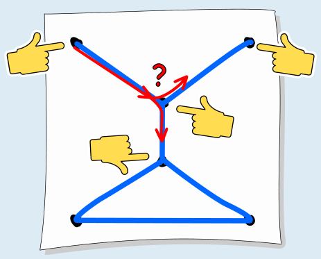

Antwort C ist richtig: So kann man das Bild in einem Zug zeichnen:

Beachte, dass in genau zwei Punkten dieser Strichzeichnung eine ungerade Zahl von Strichen zusammentreffen, nämlich drei. Diese beiden Punkte sind Anfangs- bzw. Endpunkt beim Zeichnen. In allen anderen Punkten treffen zwei, also eine gerade Anzahl von Strichen zusammen. Das muss bei allen Strichzeichnungen so sein, die man in einem Zug zeichnen kann: Zu jedem Strich, mit dem man bei einem Punkt ankommt, muss es einen Strich geben, mit dem man vom gleichen Punkt aus weiter zeichnet. Kommt man evtl. noch einmal beim gleichen Punkt an, muss es einen anderen Strich geben, mit dem man weiter zeichnet – denn jeder Strich darf ja nur einmal gezeichnet werden. Die bei einem Punkt ankommenden und von ihm wegführenden Striche bilden also Paare, so dass eine gerade Anzahl von Strichen dort zusammentreffen. Die einzigen Ausnahmen sind der Anfangs- und der Endpunkt: Beim Anfangspunkt zeichnet man los, ohne vorher angekommen zu sein. Und beim Endpunkt kommt man an, ohne weiter zeichnen zu müssen.

Bei Antwort A gibt es vier Punkte, an denen eine ungerade Anzahl von Strichen zusammentreffen.

Auch bei Antwort B gibt es vier Punkte, an denen eine ungerade Anzahl von Strichen zusammentreffen. Beim Knoten in der Mitte oben sieht man gut, dass eine ungerade Zahl von zusammentreffenden Strichen das Zeichnen in einem Zug verhindert. Die Zeichnung von Antwort D besteht aus zwei nicht verbundenen Teilen, dem Dreieck innen und dem Quadrat außen. So etwas kann man nur zeichnen, wenn man den Stift mittendrin vom Blatt abhebt.

## Das ist Informatik!

Die Strichzeichnungen bestehen aus Punkten sowie aus Strichen, die diese Punkte verbinden. Mit solchen Zeichnungen kann man auch einen *Graph* darstellen. Ein Graph besteht aus einer Menge von Knoten (als Punkte dargestellt) und einer Menge von Kanten (Paare von Knoten, als Striche dargestellt). Mit dieser mathematischen Struktur lassen sich Beziehungen zwischen Objekten sehr gut modellieren und weitere Informationen daraus ableiten.

Zum Beispiel stellen die Kanten die direkten Beziehungen zwischen je zwei Objekten dar. Folgen von Kanten, die von einem Startpunkt aus über einen oder mehrere Zwischenpunkte zu einem Endpunkt führen, werden als Pfade bezeichnet und liefern Informationen über indirekte Beziehungen.

Gibt es in einem Graphen einen Pfad, der über jede Kante genau einmal führt, kann man diesen Pfad in einem Zug zeichnen – wie bei Antwort C in dieser Biberaufgabe. Ein solcher Pfad wird als Eulerscher Pfad bezeichnet, benannt nach Leonhard Euler (1707-1783). Euler lebte in Königsberg und versuchte, einen Weg über die sieben Brücken in dieser Stadt zu finden, der über jede Brücke genau einmal führt. Euler stellte fest, dass es in dem Graph, den er aus den Ufern und Brücken bildete, eben keinen Eulerschen Pfad gibt. Seine Überlegungen begründeten das mathematische Gebiet der Graphentheorie. In der Informatik sind Algorithmen bekannt, mit denen man leicht bestimmen kann, ob es in einem Graph einen Eulerschen Pfad gibt und, wenn ja, einen solchen Pfad finden kann.
