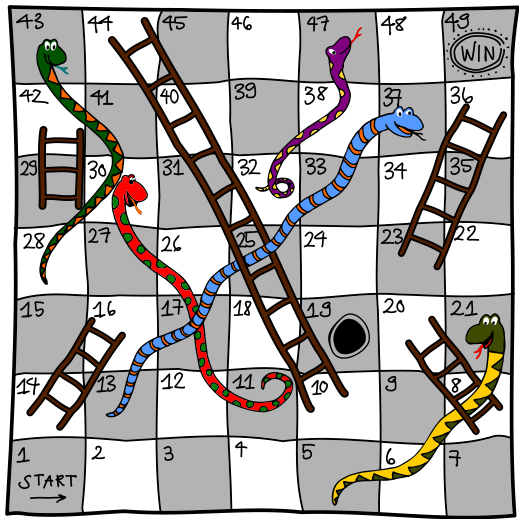

Beim Leiterspiel starten alle Spieler auf Feld 1. Wer zuerst Feld 49 erreicht, gewinnt.

In jeder Runde würfelt man eine Zahl zwischen 1 und 6 und zieht mit seiner Figur entsprechende viele Felder vor. Endet man dabei auf einem Feld mit dem Kopf einer Schlange, schlittert man hinab bis zum Feld mit ihrem Schwanzende. Endet man aber am Fuß einer Leiter, darf man diese sofort ganz hinaufklettern.

Ein Beispiel: Du stehst auf Feld 26 und würfelst eine 3. Du ziehst also auf Feld 29 und darfst über die Leiter sofort zum Feld 42 vorrücken. In der nächsten Runde würfelst du eine 5, landest auf dem Schlangenkopf des Feldes 47 und musst sofort zurück zum Feld 32.

Deine Figur steht auf Feld 19.

**Wie viele Runden brauchst du mindestens noch, um das Feld 49 zu erreichen?**
