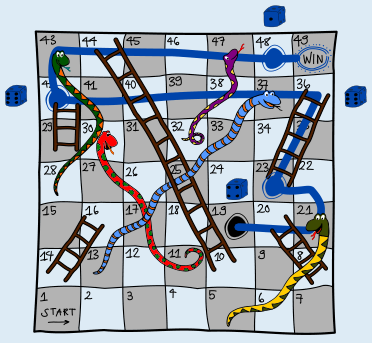
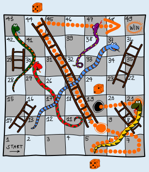

Antwort B ist richtig:

Wenn du nur Würfe berücksichtigst, mit denen du in Richtung Ziel kommst, brauchst du mindestens 4 Runden: Mit einer 4 kommt man von 19 zu 23 und per Leiter zum Feld 36. Von dort aus gibt es keine weiteren Leitern nach oben. Man braucht weitere 3 Würfe, zum Beispiel 6 – 6 – 1, um das Ziel, also Feld 49 zu erreichen (linkes Bild).

Wenn du aber einen Schritt zurück und damit eine scheinbare Verschlechterung in Kauf nimmst, schaffst du es in 3 Runden, mit den Würfen 2 – 5 – 5. Von der 19 zur 21 und die Schlange hinunter zu Feld 5. Dann zu 10 und über die Leiter hinauf zu 44, und dann ins Ziel (rechtes Bild).

 

In 2 Runden ist das Ziel nicht zu erreichen. Nur einen Wurf vom Ziel entfernt sind die Felder 48, 46, 45 und 44 (auf 47 kann man nicht bleiben). Keines dieser Felder ist von Feld 19 aus in einer Runde zu erreichen.

## Das ist Informatik!

In dieser Biberaufgabe wurde ein kürzester Weg gesucht, von Feld 19 bis zum Ziel. Dabei war der kürzeste Weg der mit den wenigsten Runden und nicht der über die wenigsten Felder. Das kennt man auch von Navigations-Apps: Dort kann der kürzeste bzw. beste Weg die Route mit der kürzesten Wegstrecke oder die mit dem geringsten Zeitverbrauch sein, während sich ein Logistikunternehmen für die Route mit den geringsten Maut-Gebühren interessiert. Der Kürzeste-Wege-Algorithmus, den die App verwendet, muss sich deshalb nicht ändern.

In der Informatik können oft die gleichen Verfahren (Algorithmen) für ganz unterschiedliche Problemstellungen verwendet werden, wenn man diese passend modelliert.
