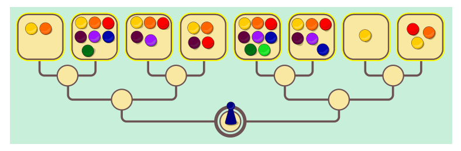

Beim Links-Rechts-Spiel gibt es acht Depots, auf die unterschiedlich viele Spiel-Chips verteilt werden. Eine Spielfigur zieht vom Startfeld aus zu einem Depot. Jedes Spielfeld hat eine Verzweigung, nach links oder rechts. Beim Startfeld entscheidet Alice, welchen Weg die Figur nimmt; bei der nächsten Verzweigung entscheidet Bob und schließlich wieder Alice. Alices Ziel ist, dass die Spielfigur ein Depot mit möglichst vielen Chips erreicht. Bobs Ziel ist hingegen, dass die Figur ein Depot mit möglichst wenigen Chips erreicht. Beide wissen voneinander, dass sie gute Spieler sind und sich immer für die Richtung entscheiden, die für ihr Ziel die beste ist.

Ein Beispiel: Wenn Bob die Figur zur Verzweigung ganz links zieht, dann weiß Bob, dass anschließend Alice die Figur auf das Depot mit 7 Spielsteinen zieht.

Ein neues Spiel beginnt, die Spiel-Chips sind verteilt.

**Welches Depot wird die Spielfigur erreichen?** (Die Depots sind von links nach rechts von 1 bis 8 nummeriert.)
