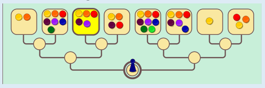
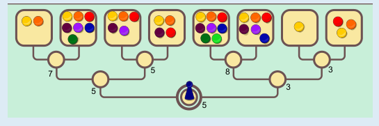

Das dritte Depot von links (mit 5 Chips) wird erreicht.

Alice weiß: Wenn sie am Anfang die Spielfigur nach rechts ziehen würde, würde Bob anschließend sicher auch nach rechts ziehen, damit Alice höchstens 3 Chips erreichen kann. Sie zieht daher am Anfang die Spielfigur nach links; dann kann sie am Ende in jedem Fall mehr als 3 Chips erreichen. Bob weiß: Wenn er die Spielfigur dann nach links ziehen würde, würde Alice 7 Chips erreichen. Daher wählt er rechts, und Alice kann höchstens 5 Chips erreichen. Zuletzt wählt Alice natürlich links, damit sie 5 Chips erreicht und nicht nur 4 Chips.

## Das ist Informatik!

Die richtige Antwort in dieser Biberaufgabe kann systematisch berechnet werden, indem man nach und nach bei den Verzweigungen aufschreibt, welches der von der Verzweigung aus erreichbaren Depots letztlich gewählt wird. An den Verzweigungen vor den Depots, bei denen Alice ihr Ergebnis maximiert, schreibt man also die größere Chip-Anzahl der beiden erreichbaren Depots auf: 7, 5, 8 und 3. Bei den Verzweigungen davor will Bob das Ergebnis minimieren; dort schreibt man also den kleineren Wert der folgenden Verzweigungen auf: 5 und 3. Beim Startfeld, wo Alice am Zug ist, wird der größere dieser beiden Werte als Endergebnis festgehalten, also 5.

Dieses Verfahren ist in der Informatik als MiniMax-Algorithmus bekannt. Damit kann man in vielen Zwei-Personen-Spielen den aktuell bestmöglichen Zug berechnen – wenn man alle Zugfolgen bis zu möglichen Endsituationen des Spiels berechnen kann. Beim Schach zum Beispiel ist das in der Regel nicht möglich, weil es zu viele solcher Zugfolgen gibt. In so einem Fall wird die Länge der Zugfolgen begrenzt und die damit erreichten Stellungen bewertet. Diese Bewertungen entsprechen den Chipzahlen der Depots in dieser Biberaufgabe. Mit dem MiniMax-Algorithmus wird dann eine Bewertung der aktuellen Stellung berechnet und der Zug, der zu dieser (besten) Bewertung führt, ausgewählt.
