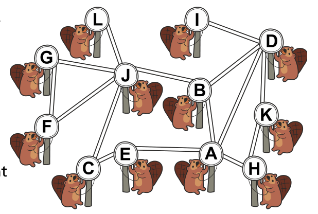

Biber verbreiten gerne Nachrichten untereinander.

Sie haben dazu ein Nachrichten-Netz (siehe Bild). Im Netz gibt es Nachbarn; sie sind durch eine Leitung miteinander verbunden. Zum Beispiel hat Biber F die Nachbarn G und J.

Die Nachrichten werden in Runden verbreitet: In einer Runde leitet jeder Biber, der eine Nachricht hat, diese gleichzeitig an alle seine Netz-Nachbarn weiter.

**Welcher Biber kann eine Nachricht in der kleinsten Anzahl Runden an alle anderen Biber im Netz verbreiten?**
