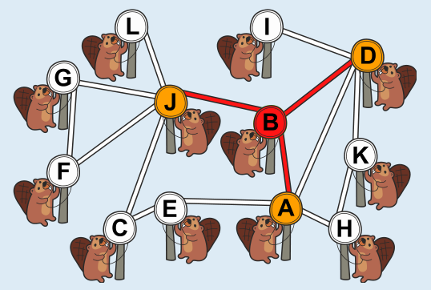
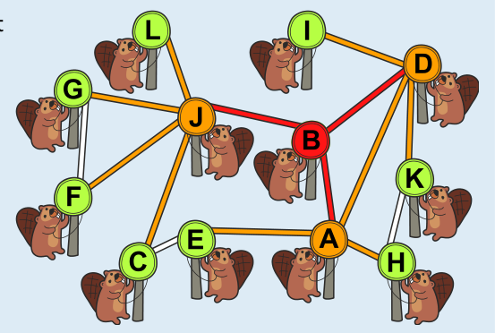

Biber B kann in nur zwei Runden eine Nachricht an alle anderen Biber verbreiten. In der ersten Runde leitet Biber B die Nachricht an alle seine Nachbarn weiter: A, D und J. Das Bild zeigt, wer nach dieser Runde die Nachricht hat.

In der zweiten Runde leiten die Biber A, D und J die Nachricht jeweils an alle ihre Nachbarn weiter:

- Biber A an die Biber E, H und D.
- Biber D an die Biber A, I und K.
- Biber J an die Biber C, F, G und L.

Außerdem geht die Nachricht jedes Mal wieder an Biber B zurück. Damit haben die Biber A, B und D die Nachricht nach der zweiten Runde doppelt. Für die Verbreitung spielt das aber keine Rolle. In nur einer Runde kann die Nachricht nicht verbreitet werden. Es gibt nämlich keinen Biber, der alle anderen Biber als Nachbarn hat.

Biber B ist der einzige, der die Nachricht in zwei Runden verbreiten kann: Die Biber C, E, F, G, H, J und L können Biber I nicht in zwei Runden erreichen. Und die Biber A, D, E, H, I und K können Biber L nicht in zwei Runden erreichen.

## Das ist Informatik!

Die Verbreitung von Nachrichten in einem Kommunikationsnetzwerk, bei der die Nachrichten immer an alle Netz-Nachbarn weitergeleitet werden, wird in der Informatik als Broadcasting bezeichnet.

Im Netzwerk in dieser Biberaufgabe ist das Broadcasting besonders schnell abgeschlossen, wenn es bei Biber B startet. Am besten und günstigsten ist ein Netzwerk, in dem das Broadcasting von allen Netzknoten aus schnell geht und das nicht unnötig viele Verbindungen hat.

Ein Kommunikationsnetzwerk kann man mathematisch auch als Graph modellieren, mit den Stationen (hier: den Bibern) als Knoten und den Verbindungen als Kanten. In der Sprache der Graphentheorie ist Biber B bzw. seine Station ein Zentrum des Graphen, der das Netzwerk darstellt. Es gibt dann keinen Knoten, der zu allen anderen Knoten eine kleinere Entfernung hätte. In der Informatik sind Algorithmen bekannt, mit denen man das Zentrum bzw. die Zentren eines Graphen effizient bestimmen kann.
