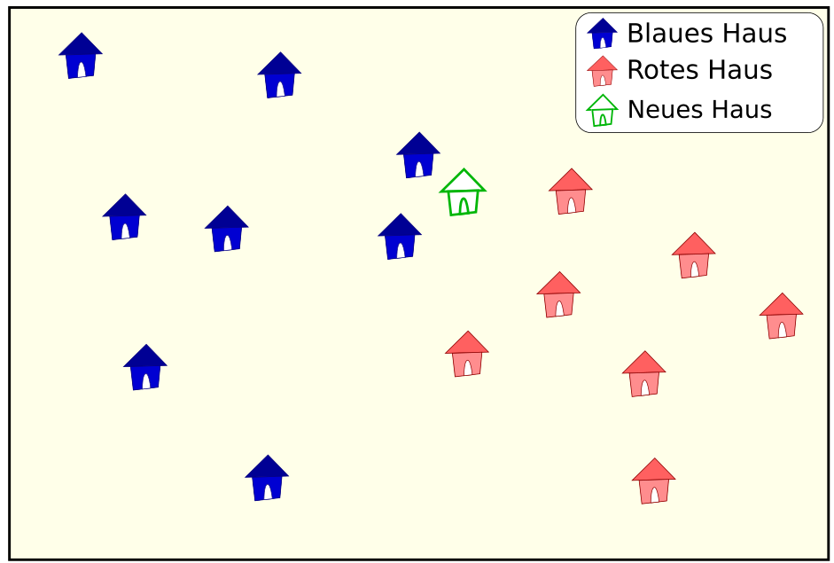

In einem Dorf werden alle Häuser entweder blau oder rot angestrichen. Um über die Farbe eines neuen Hauses zu entscheiden, haben die Bewohner eine Zahl *k* und diese Regel festgelegt:

- Ein neues Haus muss die Farbe bekommen, welche die Mehrheit der *k* nächstgelegenen Häuser hat. Wenn es keine Mehrheit gibt, entscheidet die Mehrheit der *k* + 1 nächstgelegenen Häuser.

Nun wurde wieder ein neues Haus gebaut. Das Bild zeigt die Lage aller Häuser im Dorf (blaue Häuser, rote Häuser und das neue Haus, nur als grüner Umriss gezeichnet).

Die Regel entscheidet, dass das neue Haus die Farbe Rot bekommt.

**Wie lautet die kleinste Zahl *k*, die zu dieser Entscheidung führt?**
