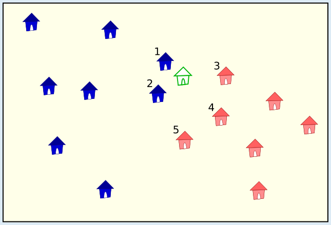

*k* = 4 ist die richtige Antwort:

Man kann die richtige Antwort finden, indem man für *k* ansteigende Zahlen einsetzt und jedes Mal prüft, ob das neue Haus gemäß der Regel die Farbe Rot bekommen muss.

Wir beginnen mit *k* = 1. Es wird nur das nächstgelegene Haus betrachtet; es ist blau. Gemäß der Regel muss das neue Haus die Farbe Blau bekommen.

Nun setzen wir *k* = 2. Die 2 nächstgelegenen Häuser sind blau. In diesem Fall besagt die Regel ebenfalls, dass das neue Haus die Farbe Blau bekommen muss.

Nun setzen wir *k* = 3. Von den 3 nächstgelegenen Häusern ist 1 rot und 2 blau. Die Mehrheit der 3 nächstgelegenen Häuser hat die Farbe Blau, und das neue Haus muss ebenfalls die Farbe Blau bekommen.

Nun setzen wir *k* = 4. Von den 4 nächstgelegenen Häusern sind 2 rot und 2 blau. Weil es keine Farb-Mehrheit gibt, muss die Mehrheit der *k* + 1 = 5 nächstgelegenen Häuser entscheiden. Von diesen haben 2 Häuser die Farbe Blau, und 3 Häuser haben die Farbe Rot – das ist die Mehrheit. Für *k* = 4 bekommt das neue Haus also die Farbe Rot. Da alle kleineren Zahlen zu einer Entscheidung für Blau geführt haben, ist 4 die kleinste Zahl, die zu einer Entscheidung für die Farbe Rot führt. Auch *k* = 5 führt zu einer Entscheidung für Rot, ist aber nicht die kleinste solche Zahl.

## Das ist Informatik!

Eine typisch menschliche Vorgehensweise ist es, Dinge „in Schubladen zu stecken“, also in Kategorien oder Klassen einzuteilen. Ob man zum Beispiel ein Ding zum Sitzen benutzen kann, ergibt sich daraus, dass man es der Klasse „Stuhl“ zuordnen kann. Dieses Klassifizieren vereinfacht das Leben, weil man nicht mehr über jedes Ding einzeln nachdenken muss.

Insbesondere Computersysteme, die Tätigkeiten von Menschen übernehmen, übernehmen damit auch das Klassifizieren: Ist ein Bankkunde kreditwürdig oder nicht? Zu welcher Risikogruppe gehört ein Kunde einer Versicherung? Zeigt ein digitales Bild einen Hund oder eine Katze?

Damit Computer klassifizieren können, benötigen sie geeignete Algorithmen. In der Informatik sind viele, zum Teil sehr leistungsfähige Algorithmen zur Klassifikation bekannt. Einen davon stellt diese Biberaufgabe vor: „*k* nächste Nachbarn“. Ein Ding wird derjenigen Klasse zugeordnet, zu der die *k* anderen Dinge gehören, die dem neuen Ding am nächsten oder nach irgendeinem Maßstab am ähnlichsten sind. Wenn man festlegt, dass *k* eine ungerade Zahl ist, gibt es immer eine Mehrheit und man kann sich die *k*+1-Regel aus der Aufgabe sparen.

In der Aufgabe gibt es nur zwei Klassen, nämlich die Farben Rot und Blau. „*k* nächste Nachbarn“ funktioniert aber auch mit mehreren Klassen. Allerdings hängt es von vielen Feinheiten ab, wie gut die Klassifizierung ist. Allgemein sollten Menschen die Qualität von klassifizierenden oder auch anderweitig künstlich intelligenten Computersystemen gründlich überprüfen.
