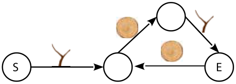
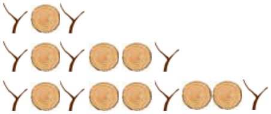
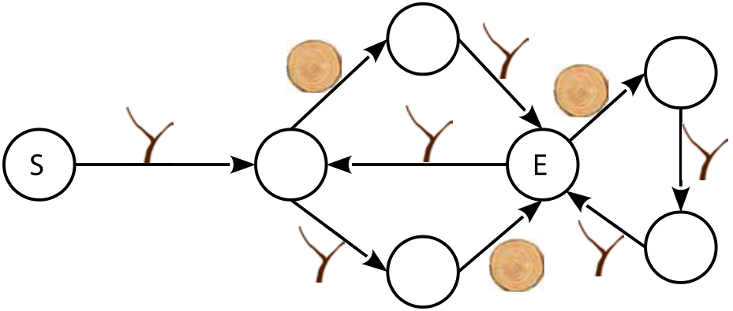

Die Biber haben eigene Regeln für Passwörter.

Die Passwörter sind aus den beiden Symbolen *Ast* (eine Astgabel) und *Baumscheibe* (eine runde Holzscheibe) aufgebaut.

Ein Diagramm legt die gültigen Passwörter fest. Ein Passwort ist dann gültig, wenn es im Diagramm einen Pfad vom Kreis S entlang der Pfeile zum Kreis E gibt, der der Reihe nach die Symbole des Passworts enthält. Andere Passwörter sind nicht gültig.

Ein Beispiel: Nach diesem Diagramm …

… sind unendlich viele Passwörter gültig, z. B.:

Die Biber erfinden ein neues Diagramm:

**Welches der folgenden Passwörter ist nach dem neuen Diagramm gültig?**
