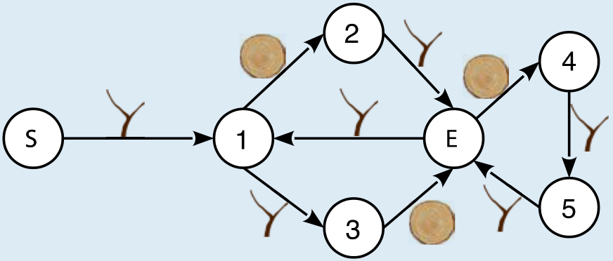

Antwort A ist richtig:

Hier ist noch einmal das neue Diagramm, mit den Nummern 1 bis 5 und den Buchstaben S und E als Bezeichnungen für die Kreise. Damit können wir Pfade im Diagramm als Folge dieser Bezeichnungen beschreiben.

**Antwort A: Das Passwort ist gültig.** Der Pfad S-1-3-E-4-5-E-1-2-E enthält die Symbole des Passworts der Reihe nach.

**Antwort B: Das Passwort ist nicht gültig.** Das erste Symbol ist eine Baumscheibe, aber alle gültigen Passwörter beginnen mit einem Ast.

**Antwort C: Das Passwort ist nicht gültig.** Der einzig mögliche Pfad, auf dem die Symbole in der Reihenfolge des Passworts enthalten sind, ist S-1-2-E-4-5-E-4. Dieser Pfad endet aber nicht beim Kreis E. Außerdem kann man erkennen, dass die Länge aller gültigen Passwörter ein Vielfaches von 3 sein muss. Das Passwort aus Antwort C hat aber 7 Symbole.

**Antwort D: Das Passwort ist nicht gültig.** Von S aus kann man genau einen Pfad gehen, der die ersten acht Symbole dieses Passworts der Reihe nach enthält: S-1-3-E-4-5-E-4-5. Dieser Pfad kann aber nicht weitergeführt werden, da von Kreis 5 aus kein Pfeil mit dem Symbol Baumscheibe weiterführt. Außerdem kann man erkennen, dass gültige Passwörter doppelt so viele Äste wie Baumscheiben haben. Das Passwort aus Antwort D enthält das Symbol Ast 5-mal und das Symbol Baumscheibe 4-mal.

## Das ist Informatik!

Zur Überprüfung möglicher Passwörter verwenden die Biber Diagramme mit Kreisen und Pfeilen, welche die möglichen Übergänge zwischen den Kreisen beschreiben. Dabei geht von jedem Kreis für jedes Symbol höchstens ein Pfeil aus, es gibt also höchstens einen nächstmöglichen Kreis. Dadurch wird die Überprüfung von Passwörtern sehr vereinfacht, weil man immer nur einen einzigen Weg durch das Passwort-Diagramm verfolgen muss.

Diagramme wie die Passwort-Diagramme in dieser Biberaufgabe werden in der Informatik auch als Zustands-Übergangsdiagramme bezeichnet. Mit ihnen kann man das Verhalten sogenannter *endlicher Automaten* beschreiben. Das sind Modelle für einfache Berechnungen: Sie haben eine Menge von Zuständen, und für jeden Zustand ist festgelegt, in welchen anderen Zustand der Automat bei der Verarbeitung einer neuen Eingabe übergeht. Bei jeder neuen Berechnung befindet sich der Automat in einem besonderen Startzustand. Genau dann, wenn der Automat nach Verarbeitung aller Eingaben einen besonders gekennzeichneten Zustand erreicht, erfüllt die Eingabe die durch den Automaten realisierten Bedingungen. Ein solcher Automat wird als *deterministisch* bezeichnet, wenn von jedem Zustand aus für jedes Eingabezeichen höchstens ein Folgezustand festgelegt wird.

Jedes Passwort-Diagramm in dieser Biberaufgabe beschreibt also einen deterministischen endlichen Automaten. Der Startzustand ist mit „S“ gekennzeichnet, und es gibt jeweils genau einen Zustand „E“, bei dessen Erreichen nach Verarbeitung aller Symbole das Passwort als gültig akzeptiert wird.
